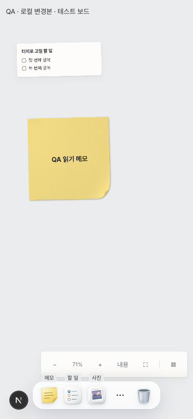

# 모바일 겹침·잘림 — 부분 구현 기록

요청: 모바일 5장면 겹침/잘림, 본문 가독성, 모바일 조작 보존, 데스크톱 비교.
유형: 화면 비교. 2026-11-14 로컬 작업. 원본 기준: 9cfdacc4a69c584567242dacc8c76a01701efbce.

현재 결과: 공유창 좌측 잘림만 수정·경계 검증. 전체 작업은 미완료(UNVERIFIED).

## 근거

출처: 실제 SharePopover/Canvas/Dock/MemoExpandDialog를 구동한 로컬 fixture. 인증·공유 서버 응답은 검증하지 않음. fixture.tsx.txt는 임시 QA route 원본이며 제품 route로 남기지 않음.
동일 조건: 390×844 CSS viewport, deviceScaleFactor 1, 같은 로컬 보드 및 공유창 props.

| 장면 | 변경 전 | 변경 후 | 번호 |
|---|---|---|---|
| 공유창 | screens/before-share.png | screens/after-share.png | ① |

보드: share-comparison.png. 원본: board/share.html.
브라우저 경계 검사 RED: `{left:-20,right:280}`, viewport 내 검사 false.
GREEN: `{left:8,right:382}`, 양쪽 8px 검사 true.

검증 명령: `cd web && bun run test src/components/share/__tests__/SharePopover.guidance.test.tsx src/components/share/__tests__/ShareControl.test.tsx` — 2 files, 10 tests passed, zero failures.
`cd web && bunx tsc --noEmit` — exit 0.
`cd web && bunx eslint src/components/share/SharePopover.tsx` — exit 0.
`git diff --check` — exit 0.

NOT RUN: 나머지 4장면 수정/회귀 검증, 데스크톱 전후 비교, 전체 시험, 실제 인증 공유 동작, 전체 changed-files check.
도구막대/선택막대/메모/링크 모달 수정은 아직 없음. 공유창의 개인정보 버튼과 겹침 해소도 실제 shell에서 미검증.

## 追加 작업 — 미완료 / UNVERIFIED
모바일 zoom 폭 제한·줄바꿈 및 선택 시 숨김, 링크 편집창 상단 64px 여백을 구현했다. 실제 브라우저 geometry는 미검증이므로 증상 해소로 판정하지 않는다.
회귀 소스 검사 2건을 먼저 실행하여 2 failed를 확인한 뒤 수정했다. 관련 fresh command: `cd web && bun run test src/components/workspace/__tests__/mobileOverlap.test.ts src/components/workspace/__tests__/ZoomBar.test.tsx src/components/workspace/__tests__/MobileLinkEditor.test.tsx` — 3 files, 14 tests passed. 소스 검사는 DOM geometry 회귀를 대체하지 않는다.
3137 listener는 lsof 검사에서 발견되지 않았다.
NOT RUN: 실제 브라우저 5장면 전후 캡처, DOM geometry, 메모 본문·제목 수정, 카드 조작막대 통합, 공유 개인정보/AI 버튼 겹침, 데스크톱 비교. 전체 빌드/전체 시험은 사용자 지시에 따라 실행하지 않았다.

### QA fixture bootstrap investigation (implementation lane)
- QA route now explicitly awaits `useStorage.init()` and `workspace.loadFromStorage()` before board creation, rather than waiting for an onboarding-owned `bootstrapComplete` signal or a 600ms timer. Initialization errors are exposed in the fixture.
- Fresh command: `npx next dev -H 0.0.0.0 -p 3137` → Ready (438ms).
- Ego space 70 / p1: CDP viewport override followed by actual `innerWidth=390`, `innerHeight=844` verification. Route still displayed only fixture header; board initialization remains UNVERIFIED. No successful before/after memo captures obtained.
- NOT RUN: full build, typecheck, full test suite (explicitly excluded); memo regression RED/GREEN and overlay overlap verification remain outstanding.

### Memo implementation lane — UNVERIFIED

- Inspected original `10-편집상세-mobile.png`: small body, visible ink line, isolated 100% action.
- Existing editor deliberately keeps a 720px canonical column whenever saved ink exists; removing ink or forcing reflow would violate coordinate preservation.
- Browser space 70/p1 reported actual innerWidth=1512, innerHeight=837 after the requested emulation, so no 390×844 before/after evidence was established in this lane. Parent server and initialization were not modified.
- Attempted focused regression test failed in its file-loading harness (`URL must be of scheme file`), not on the product symptom. Removed that newly created invalid test. No product fix or GREEN result claimed.
- NOT RUN: full build/typecheck/test (explicitly prohibited); mobile visual acceptance and desktop regression remain unverified.

### Canonical ink fixture (implementation lane, 2026-11-14)
- QA route now calls production `setOverlay` for the existing QA reading memo, using `{paths:[[{x,y},...]]}` with one diagonal stroke. Browser confirmed `data-memo-layout="canonical"`.
- Mobile evidence is UNVERIFIED: after CDP requested 390×844, a fresh browser evaluation returned **1512×837**. The explicit viewport assertion failed; no mobile before/after screenshot is claimed.
- Existing canonical policy test requires default fit and a reversible explicit 100% toggle. Changing that default needs a product policy decision. No production layout or existing tests were changed in this lane.
- NOT RUN: new RED/GREEN regression, related test suite, desktop/touch/44px checks, full build/test (excluded by task).

### Compact dock label correction (implementation sub-agent)
- Compact-only CSS places labels in normal flow beneath 28px icons, inside 48px buttons; desktop tooltip positioning is unchanged.
- Preserved actual 390×844 DPR2 original as [before-toolbar](screens/before-toolbar.png).

- AFTER: UNVERIFIED. Requested parent tab is inaccessible from delegated thread: preview.evaluate and preview.open both returned PreviewAutomationTabNotFoundError. No fabricated after screenshot or viewport JSON is attached.
- Static regression RED: mobileOverlap.test.ts new label assertion failed before fix; GREEN after fix. This is not a bounding-rect geometry test.
- Related test command: bun run test src/components/workspace/__tests__/mobileOverlap.test.ts src/components/workspace/__tests__/Dock.test.tsx src/components/workspace/__tests__/Dock.linkTodoPhoto.test.tsx src/components/workspace/__tests__/canvasControls.test.ts src/components/workspace/__tests__/MobileCardControls.test.tsx
- Result: 58 passed, 1 failed, 2 pre-existing skipped. Failure: Dock.test.tsx compact link creation expects dialog "링크 주소 수정"; not changed or weakened.
- Includes existing partial zoom CSS (viewport max-width/wrapping/selected zoom hiding) and existing Dock selected-state change in the same commit.
- NOT RUN: actual bounding-rect RED/GREEN, after viewport JSON/780×1688 PNG, full build/test (prohibited). Parent must verify actual toolbar and desktop geometry; server remains running. Memo policy unchanged by this slice.

## Implementation follow-up 2026-11-14

README 58-pass/1-fail was Dock.test.tsx, compact dock / opens by keyboard, creates a link memo, and closes. Fresh reproduction: dialog missing, 56 passed / 1 failed / 2 existing skipped across four focused files. Compact controls now belong to Canvas MobileCardActions; Dock-only harness omitted that owner. Mounted MobileCardActions in that test, retaining all dialog, focus, state and cancel assertions. Fresh focused run: Dock, MobileCardControls, MobileLinkEditor, ZoomBar — 57 passed, 2 existing skipped. No test skipped or weakened.

Local commits: 946d276 selection consolidation + harness; fa9184d link top64; fc2b903 selected zoom attribute (CSS already in 11a17d4). AGENTS and memo policy files excluded.

Own isolated tab: tab_3_b3fff760-e9f9-4bb0-ae9c-345480a9d63c; direct preview.open succeeded. Actual browser evaluation asserted innerWidth=390, innerHeight=844, devicePixelRatio=2. All four new PNG snapshots report 780x1688 and were visually inspected. Existing saved URL https://example.com/mobile-qa reopened in address editor; rect x8,y64,width374,height223.390625, bottom287.390625; viewport/header geometry assertion passed. Desktop emulation does not verify an actual iOS software keyboard.

| Scene | Evidence | Result |
|---|---|---|
| Initial dock | [after](screens/impl-after-initial.png), [before floating label](screens/verified-after-initial.png) | labels inside dock, zoom above dock |
| Selection | [after](screens/impl-after-selection.png) | one bottom action row; zoom hidden |
| Existing link edit | [after](screens/impl-after-existing-link-edit.png) | stored URL loaded; dialog below header, inside viewport |
| Share | [after](screens/impl-after-share.png) | FAIL: existing privacy/AI button overlaps share text; policy awaiting user, untouched |

Noninitial before captures remain UNVERIFIED; no baseline restored. NOT RUN: full build/tests (prohibited), physical mobile keyboard. Server preserved. One rejected selector click: PreviewAutomationInvalidSelectorError, “No element matches the selector, so no input was sent.” Recovered by observed button text and direct evaluation; capture was not blocked.

### Share overlap fix — verified 2026-11-14
- Own GOAT tab `tab_4_b3fff760-e9f9-4bb0-ae9c-345480a9d63c`, actual viewport 390×844 DPR2. Before/after PNG dimensions 780×1688; visually inspected after.
- BEFORE: dialog (8,60,374,282.859375), privacy control (11.25,108,104.1875,41.25). `elementFromPoint(60,125)` returned privacy button. Dialog z43 is contained by parent z40; increasing child z-index cannot escape that stacking context.
- Minimal mobile-only change: while share panel exists, suppress the underlying canvas privacy control with visibility:hidden. Closing share restores visibility; privacy policy/state is unchanged. Desktop 1280px verified privacy remains visible and popover remains absolute.
- AFTER PASS: heading rect (26,78,338,24), center hit is heading; former overlap point hits dialog. Hidden privacy has no painted/hittable overlap. Panel remains x8..382 below top safe area.
- Evidence: [before](screens/share-overlap-before.png), [after](screens/share-overlap-after.png), [viewport and hit-test](screens/share-overlap-after.viewport.json). Existing FAIL evidence retained.
- Regression RED: SharePopover.mobile.test.ts 1 failed before implementation. GREEN: focused mobile/guidance/ShareControl tests 3 files, 11 passed, zero failures. Source regression is supplemented by the actual DOM checks above.
- NOT RUN: full build/test (user prohibited), physical mobile device, desktop pixel comparison, server authentication flow. Server preserved; memo policy untouched.
