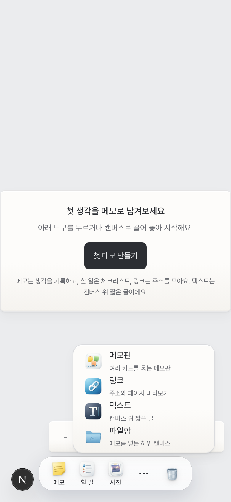
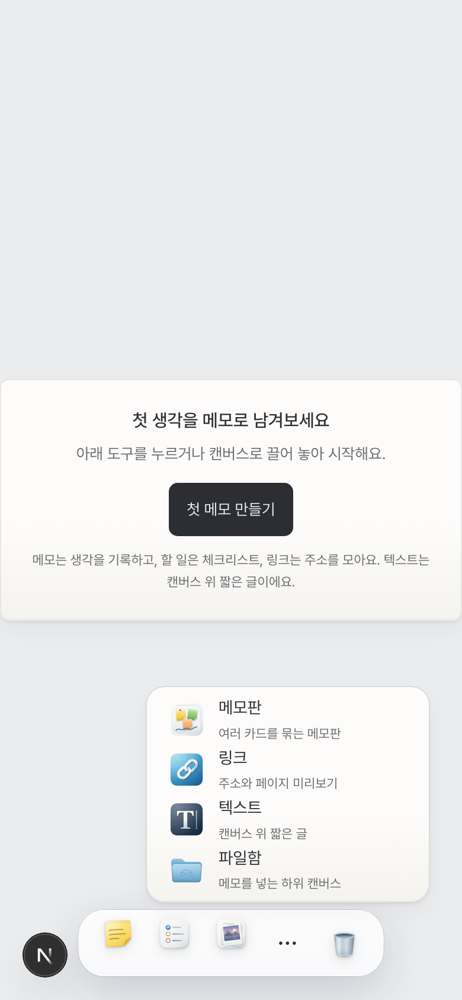

# Mobile More menu — UNVERIFIED reported symptom

Inspected current HEAD b231761 with actual product Canvas + Dock, using the saved local QA fixture (no SharePopover import). GOAT direct preview open/resize/click/evaluate/snapshot; 390×844 CSS pixels, DPR 2, screenshot 780×1688.

The reported zoom label bleed-through was **not reproduced**. At the zoom label center (157,734), elementFromPoint returned the folder icon in the menu. Menu opacity is 1, z-index 50; the computed gradient has opaque RGB stops (#fdfcfa / #f5f3ef). A transparent background-color does not make an opaque background-image translucent. The screenshot shows the zoom label covered, with the minus button outside the menu still visible.

No product change or artificial RED test was made. No after image is claimed. Requires the actual failing state to establish a behavioral regression before changing CSS. Existing uncommitted AGENTS/screens were excluded. No device, port 3000, PR, push, merge or deployment actions.

NOT RUN: regression RED/GREEN, related Dock/ZoomBar tests, keyboard/menu-action checks, desktop comparison (no product changes).

Temporary local route and owned port 3014 server removed/stopped after capture. Fixture only changes in-memory workspace state; no board/card persistence API was invoked.

## Additional hiding fix verification — 2794991

The historical before.png and viewport.json above are the source baseline b231761 (same saved fixture, 390×844, DPR 2). They show the exposed minus at the left of the menu. The new after-hidden.png is actual product Canvas + Dock (including ZoomBar), not a mockup. Direct GOAT preview API on an owned isolated tab and owned server 3016.

Direct visual inspection: minus and zoom strip absent, dock captions absent, menu remains readable. PNG verified 780×1688. Measurements: [JSON](after-hidden.viewport.json). Zoom computed visibility hidden, programmatic focus rejected, old minus center (110.625,734.25) hits canvas. Dock captions hidden. Escape restores trigger focus, zoom and captions. Reopen and select 텍스트 creates an active 텍스트 입력 textbox and removes the empty state. Reload reseeds this fixture to zero cards and restores empty state; isolated tab closed. Temporary route removed and owned 3016 stopped; existing 3000 unchanged.

Limitations: Tab traversal was not separately exercised. The existing in-memory fixture emits unattached Yjs type warnings; durable persistence is not validated. No product changes were needed. Documentation and evidence only; original AGENTS and unrelated screenshots excluded.

NOT RUN: build (outside scope), tests/lint/typecheck (no product changes), separate Tab traversal, durable card persistence.
