# moss 로그인 오른쪽 사진 후보 (2026-10-01)

Claude 로그인 화면 오른쪽 사진 감성(메모 벽 앞 생각하는 사람, 바랜 따뜻한 톤)으로 모은 Unsplash·Pexels 사진. `mock/`은 moss 로그인 목업에 넣어 본 것.

## 1순위 (목업 있음)

### 02. 포스트잇 벽 앞에 선 매니저

검은 벽 메모+생각하는 사람, 다큐 톤 — Pexels · cottonbro studio · <https://www.pexels.com/photo/man-standing-in-front-of-a-wall-with-sticky-notes-in-an-office-and-thinking-6804078/>

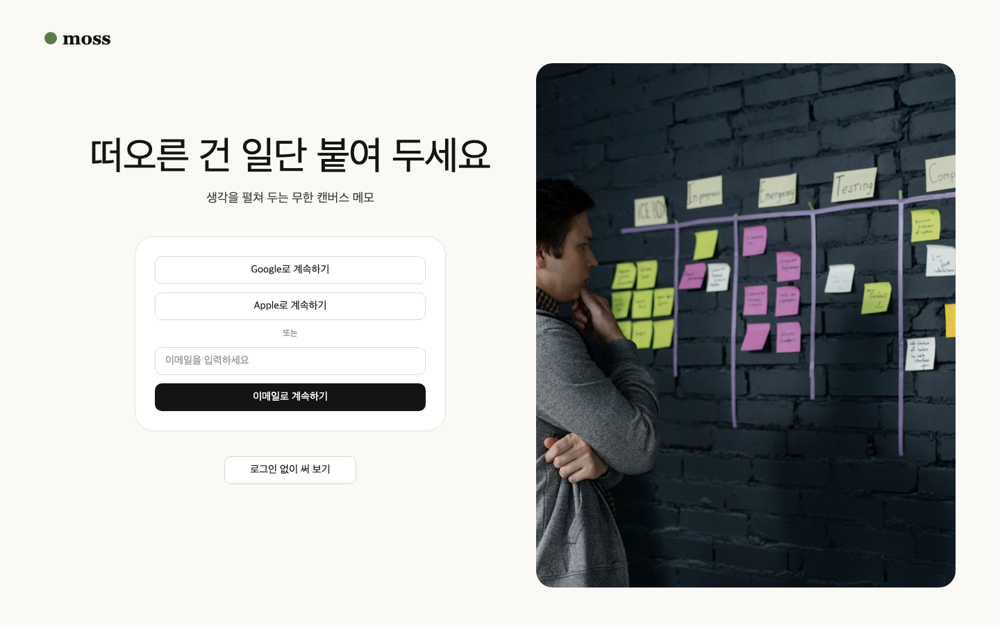

### 04. 핀보드 메모를 읽는 남자

코르크보드·따뜻한 톤·옆모습 몰입 — 기준 사진과 가장 가까움 — Pexels · Zen Chung · <https://www.pexels.com/photo/serious-ethnic-guy-reading-sticky-notes-attached-to-pinboard-5745179/>

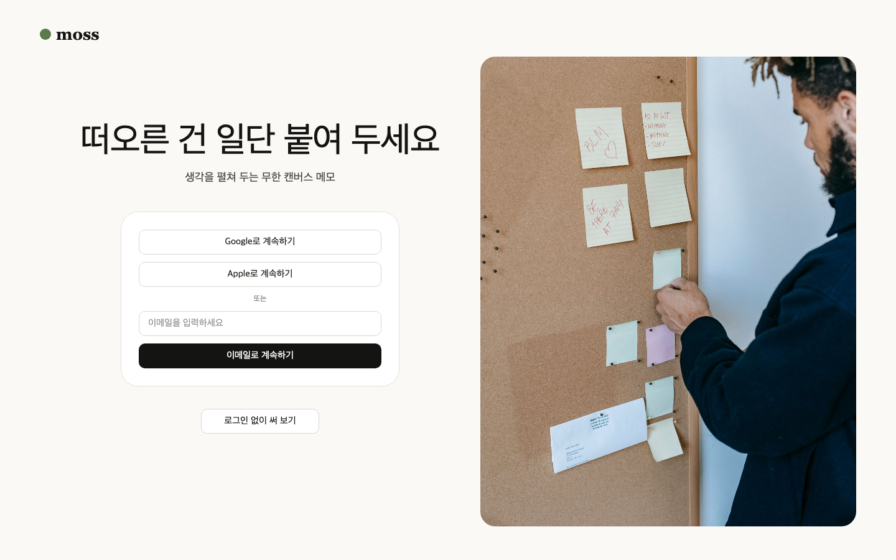

### 05. 포스트잇 벽을 보는 여자

턱에 손 올리고 메모 벽을 보는 구도가 기준과 같음 — Unsplash · Vitaly Gariev · <https://unsplash.com/photos/woman-looking-at-colorful-sticky-notes-on-wall-tjX-YLZRVzg>

### 11. 벽 가득 메모 콜라주

사람 없이 종이 콜라주만 — 텍스처 배경으로 강함 — Pexels · Diana · <https://www.pexels.com/photo/assorted-notes-on-wall-2969925/>

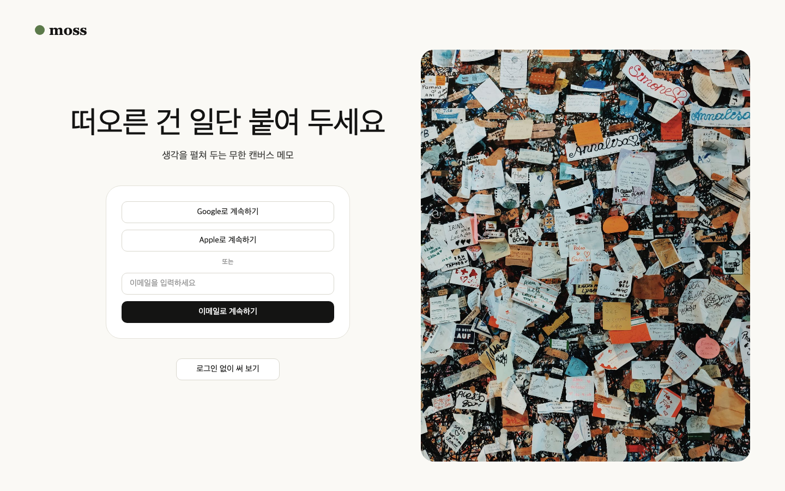

### 17. 책상에서 생각에 잠긴 남자

종이 더미 책상에서 머리 짚은 사람 — 모티프 일치, 색은 밝은 편 — Pexels · RDNE Stock project · <https://www.pexels.com/photo/man-sitting-at-his-desk-thinking-7581008/>

### 19. 창가 책상에서 종이에 필기

오래된 책상·액자·손 — 빈티지 무드 — Pexels · Kübra Arslaner · <https://www.pexels.com/photo/a-person-writing-on-white-paper-8235821/>

### 23. 따뜻한 조명 아래 무드보드 작업

따뜻한 조명 아래 무드보드 벽 — 감성 최상, 다소 어두움 — Pexels · Daniel & Hannah Snipes · <https://www.pexels.com/photo/creative-design-studio-mood-board-arrangement-37178210/>

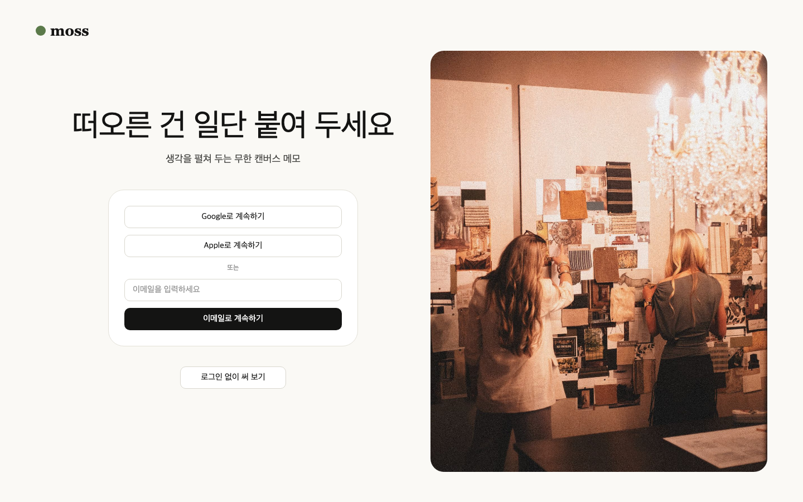

### 24. 스튜디오에서 무드보드 정리하는 여자

무드보드에 사진 붙이는 뒷모습, 필름 톤 — Pexels · Daniel & Hannah Snipes · <https://www.pexels.com/photo/interior-designer-curating-mood-board-in-studio-37178223/>

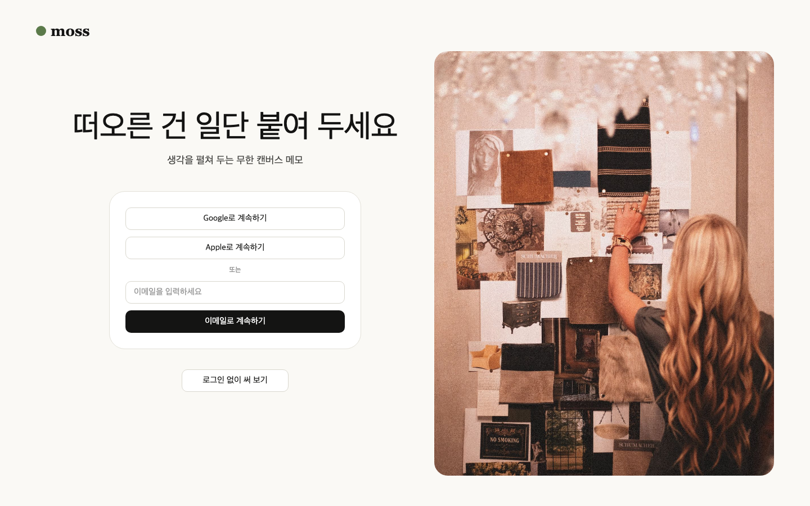

### 25. 창가에서 노트에 쓰는 남자

창가 자연광, 턱 괴고 노트 — 차분한 사색 — Pexels · Mizuno K · <https://www.pexels.com/photo/vertical-shot-of-a-man-writing-in-a-notebook-with-left-hand-by-a-window-12899122/>

### 26. 창가에서 일기 쓰는 여자

바랜 필름 톤, 고개 숙여 쓰는 사람 — Pexels · Huỳnh Như Mavi · <https://www.pexels.com/photo/woman-writing-in-journal-by-a-window-37129604/>

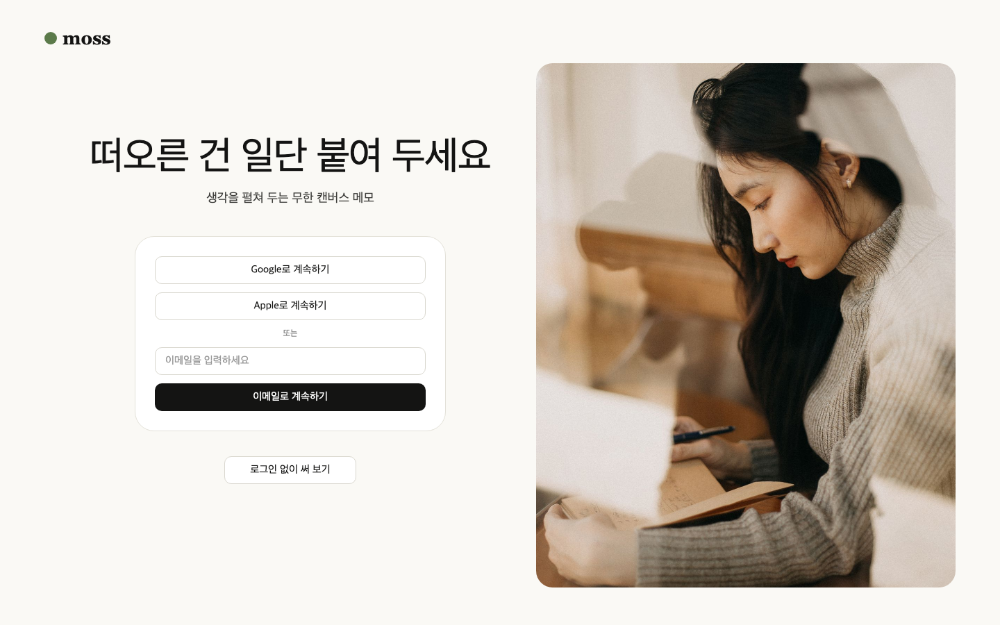

## 2순위

### 01. 메모 벽 앞에서 생각하는 남자

기준 이미지와 가장 근접한 구도로, 벽 가득 붙은 메모 앞에서 pensively 서 있는 필름톤 세로 컷. — Unsplash · Tommy Mason · <https://unsplash.com/photos/a-man-standing-in-front-of-a-wall-with-sticky-notes-on-it-c7qJLpNG5QY>

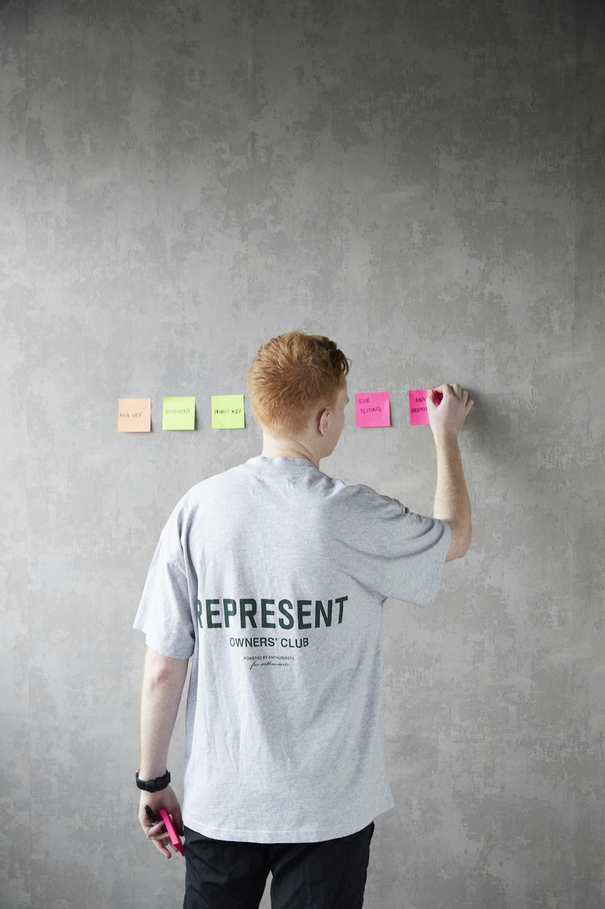

### 03. 과제를 벽에 정리하는 남자

손으로 메모를 붙이며 벽을 정리하는 장면, 광고 톤이 적고 작업실 분위기. — Pexels · cottonbro studio · <https://www.pexels.com/photo/project-manager-planning-tasks-6804091/>

### 06. 포스트잇 벽 앞 두 사람

메모 벽 앞에서 이야기 나누는 두 사람, 협업 분위기의 에디토리얼 컷. — Unsplash · Vitaly Gariev · <https://unsplash.com/photos/two-people-brainstorming-with-sticky-notes-on-wall-ynkz9cpyvzI>

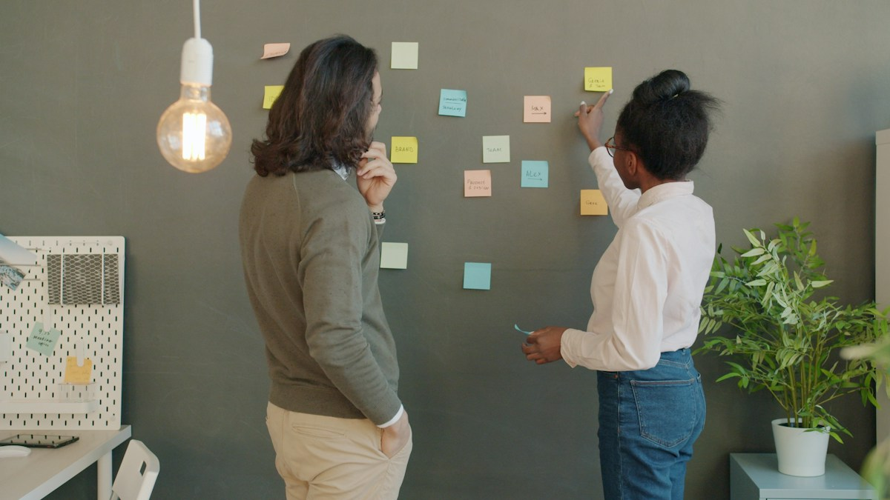

### 07. 메모를 붙이는 뒷모습

벽에 메모를 붙이는 뒷모습으로 무한 캔버스에 붙이는 행위와 직접 대응. — Unsplash · Vitaly Gariev · <https://unsplash.com/photos/woman-adding-colorful-sticky-notes-to-a-wall-sVJ7FbTKqoM>

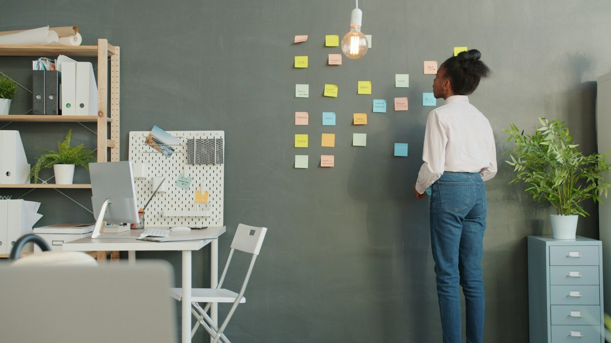

### 09. 메모 벽에 글씨 쓰는 남자

흰 벽에 노란 메모를 쓰는 클로즈 작업 컷, 배경이 단순해 텍스트 얹기 좋음. — Pexels · Yan Krukau · <https://www.pexels.com/photo/a-man-writing-on-a-yellow-sticky-note-posted-on-the-white-wall-7793696/>

### 15. 메모지를 붙이는 여자 측면

측면에서 메모를 붙이는 손 중심 컷, 인물 얼굴이 크지 않아 배경용으로 좋음. — Pexels · Mikhail Nilov · <https://www.pexels.com/photo/a-woman-sticking-a-stick-note-6592666/>

### 16. 노트북 옆 손으로 필기

종이에 손으로 쓰는 세로 클로즈업, 노트와 노트북이 함께 보이는 작업 맥락. — Pexels · Jakub Zerdzicki · <https://www.pexels.com/photo/hands-writing-in-notebook-on-modern-office-desk-34862446/>

### 20. 메모에 펜으로 쓰는 손

메모에 펜으로 적는 세로 컷, 책상 위 도구들이 담백하게 잡힘. — Pexels · cottonbro studio · <https://www.pexels.com/photo/person-writing-on-a-sticky-note-7429465/>

### 21. 코르크보드 위 메모

코르크보드에 손글씨 메모가 빽빽한 세로 컷, 기준 이미지의 벽 질감과 유사. — Pexels · Polina Zimmerman · <https://www.pexels.com/photo/notes-on-board-3782131/>

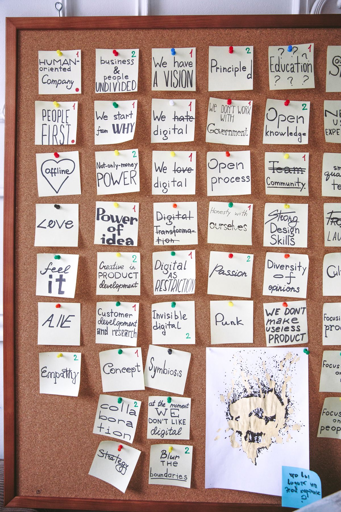

### 22. 코르크보드에 붙은 메모

워크숍 분위기의 코르크보드 메모 신, 색이 차분하고 스톡 느낌이 덜함. — Unsplash · Jo Szczepanska · <https://unsplash.com/photos/sticky-notes-on-corkboard-5aiRb5f464A>

### 27. 햇빛 아래 노트에 필기

손과 노트에 드리운 자연광 그림자 클로즈업, 필름 같은 담백한 빛. — Pexels · Alex Dos Santos · <https://www.pexels.com/photo/handwriting-on-notepad-with-sunlight-cast-shadows-37822453/>

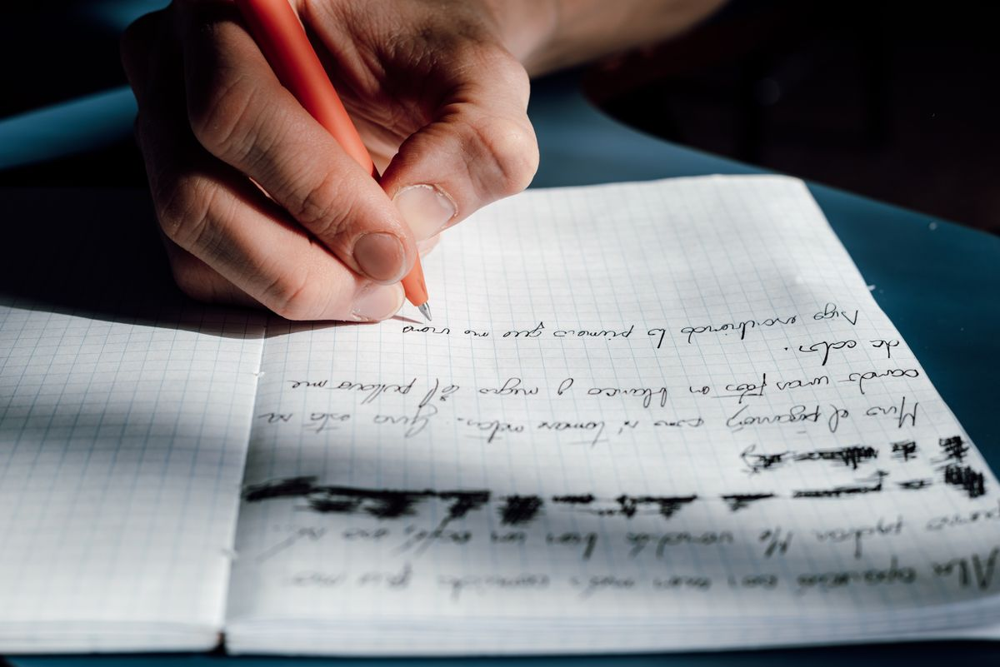

## 제외

### 08. 메모에 둘러싸인 노트북 작업

유리벽 가득 메모 속에서 노트북으로 작업하는 장면, 몰입감 있는 다큐 톤. — Unsplash · Vitaly Gariev · <https://unsplash.com/photos/man-working-on-laptop-surrounded-by-colorful-sticky-notes-xzO9iPDZkyI>

### 10. 유리벽 포스트잇 정리하는 여자

유리벽을 메모로 채우는 장면, 색은 다소 차갑지만 구성이 단정함. — Pexels · Vitaly Gariev · <https://www.pexels.com/photo/young-woman-organizing-post-it-notes-on-glass-wall-36765682/>

### 12. 유리판 위 메모지들

사람 없이 메모만 붙은 세로 클로즈업, 배경으로 쓰기 좋은 정돈된 질감. — Pexels · Mikhail Nilov · <https://www.pexels.com/photo/sticky-notes-on-the-glass-wall-6592368/>

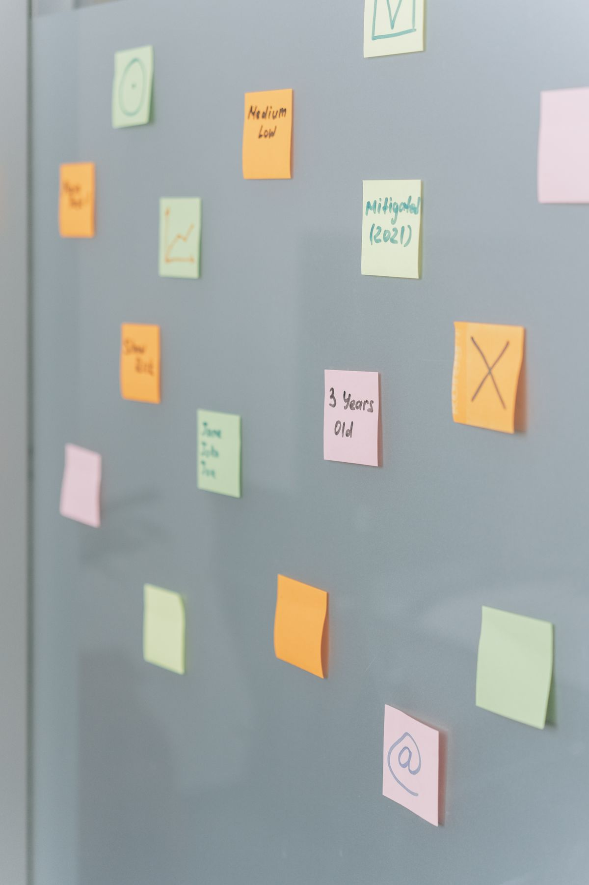

### 13. 메모 붙이는 손

손이 메모를 붙이는 순간만 담은 세로 클로즈업, 앱의 붙이기 행위와 직결. — Pexels · Polina Tankilevitch · <https://www.pexels.com/photo/a-person-posting-sticky-notes-on-white-wall-6700497/>

### 14. 화이트보드에 메모 놓는 손

손과 메모만 있는 미니멀 클로즈업, 광고 느낌이 적고 담백함. — Pexels · Walls.io · <https://www.pexels.com/photo/hand-placing-sticky-note-on-whiteboard-15505431/>

### 18. 흰 책상 위 흩어진 메모

사람 없이 책상 위에 펼쳐진 메모·노트 플랫레이, 무한 캔버스 감성과 맞음. — Pexels · Tara Winstead · <https://www.pexels.com/photo/sticky-notes-scattered-on-white-desk-8386687/>

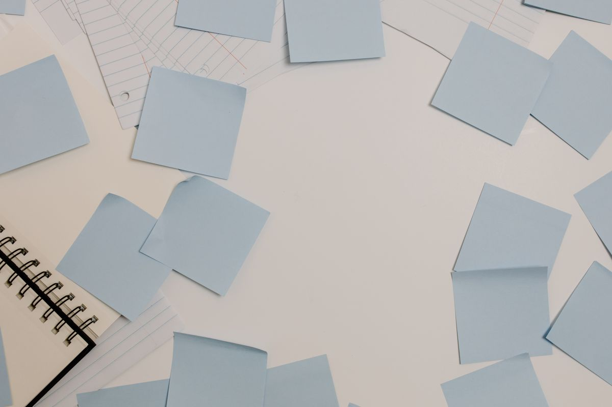

## 참고 사례

- [로그인 분할 화면 + 사진 (Shadcn UI Blocks)](https://www.shadcn-ui-blocks.com/blocks/application/login/split-with-image)
- [회원가입 분할 + 풀하이트 이미지 (shadcnblocks)](https://www.shadcnblocks.com/block/signup10)
- [로그인 분할 + 소셜 인증 (Creative Tim)](https://www.creative-tim.com/ui/block/authentication-02)
- [계정 생성 UI + 이미지 패널 (v0)](https://v0.app/templates/modern-account-creation-ui-with-image-panel-mraFpJTZdoR)
