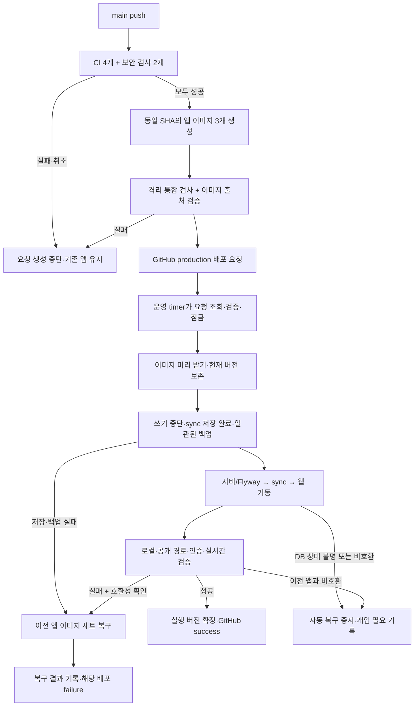

# Moss 배포 자동화 계획

상태: 계획 수립. 2026-11-12. 운영·워크플로·시크릿 변경은 아직 실행하지 않았다.

## 목표와 확정한 정책

`main`에 반영된 커밋의 CI와 보안 검사가 모두 통과하면 웹·Ktor 서버·실시간 동기화를 하나의 버전으로 자동 배포한다. 컨테이너 교체 중 짧은 접속 중단과 실시간 연결 재접속은 허용한다. 사용자가 이 세 정책을 직접 확정했다.

현재 산출물은 계획이다. 구현은 자격 증명·배포 권한·릴리스 계약·DB 호환성에 걸치는 C4 작업으로 분류한다. 구현 전 완료 조건을 합의하고, 독립 검토와 격리 환경의 배포·복구 검증을 거친다. 이 문서는 운영 활성화 승인을 대신하지 않는다.

## 현재 확인한 상태

기준 소스는 `main`의 PR #27 병합 커밋 `4b617ad3389287c51e6dafc19ce1216e1bf7b3df`다. 2026-11-12 확인 결과이며 구현 시작 시 다시 확인한다.

| 항목 | 관찰한 상태 | 설계에 미치는 영향 |
|---|---|---|
| GitHub Actions | `ci.yml` 검사 4개와 `audit.yml` 보안 검사 2개. 배포 작업 없음 | 두 워크플로가 같은 커밋에서 모두 성공해야 배포 가능 |
| GitHub 배포 구성 | production Environment 없음, 이 저장소에 등록된 self-hosted runner 0개 | 배포 이력과 권한 구성을 새로 준비 |
| 운영 호스트 | Linux amd64, Docker 27.3.1, Compose 2.29.7 | 이미지는 GitHub에서 linux/amd64로 생성 |
| 외부 진입 | cloudflared가 웹 3001·API 8080·sync 1234의 loopback으로 분기. `/internal` 외부 차단 | 현재 라우팅 유지. 공개 SSH에 의존하지 않음 |
| 앱 실행 | 로컬에서 빌드한 이미지. 모든 컨테이너 restart policy `no`. 웹·sync healthcheck 없음 | 고정 digest·준비 상태 검사·재시작 정책 필요 |
| 버전 식별 | 운영 checkout `e351374`, 웹 OCI revision은 `38afee6c`로 불일치 | checkout이나 라벨만으로 운영 코드 판단 금지 |
| DB | 서버 시작 시 Flyway 실행. 적용된 운영 migration 이력은 미확인 | 초기 기준선 확인, 이전 앱과 DB 호환성 검증 필요 |
| 백업 | 일일 백업 cron 항목은 존재. 실행 성공·복원 가능 여부는 미검증 | 첫 활성화 전 복원 리허설 필요 |

근거: [운영 읽기 전용 조사](goat-thread://v1/mcp:57b0ad43-9829-4335-a677-a106dfccf033), [CI](../.github/workflows/ci.yml), [보안 검사](../.github/workflows/audit.yml), [docker-compose.prod.yml:19](../docker-compose.prod.yml), [Database.kt:119](../server/src/main/kotlin/com/moss/server/Database.kt), [backup.sh:14](../scripts/backup.sh).

현재 공개 `/health`는 API 서버만 검사한다. 웹 배포 성공의 증거로 사용할 수 없다. 기존 CI 설계는 [배포 자동화를 범위 밖](moss-ci.md)으로 두고 있다(`moss-ci.md:21`).

## 배포 구조

GitHub-hosted Actions에서 검증과 이미지 생성을 수행하고, 운영 호스트의 전용 systemd timer가 HTTPS로 배포 요청을 가져온다. 운영 서버에서 빌드하지 않는다. 기존 다른 프로젝트의 runner를 재사용하지 않는다.

배포 요청 생성과 운영 성공은 다른 상태다. Actions의 마지막 작업은 해당 deployment ID의 최종 상태를 제한 시간 내 확인한다. 이미지 업로드나 요청 생성만으로 전체 배포를 녹색 처리하지 않는다. 호스트가 오프라인이면 이전 서비스를 유지하고 배포를 대기/시간 초과로 표시한다.

## 1. 검증·이미지 생성·배포 요청

- `.github/workflows/release.yml`을 `main` push의 진입점으로 둔다. `ci.yml`과 `audit.yml`에 `workflow_call`을 추가해 기존 검사를 재사용한다. 기존 PR 검사는 유지하고 main의 중복 실행은 없앤다. 보안 검사에는 필요한 `NVD_API_KEY`만 명시적으로 전달한다.
- `needs`로 CI와 보안 검사 양쪽 성공에 종속시킨다. 한 검사라도 실패·취소·누락되면 이미지 승격과 운영 요청을 생성하지 않는다. `workflow_run: [ci, audit]`는 둘 중 하나만 끝나도 실행되므로 이 용도로 사용하지 않는다.
- 모든 checkout·검사·빌드는 이벤트의 고정 SHA를 사용한다. 승인되지 않은 PR 코드나 PR artifact를 배포 경로에서 실행하지 않는다. 외부 Actions는 검토한 commit SHA로 고정한다.
- 웹·서버·sync 세 이미지를 GHCR에 저장하고 `image@sha256:...`로 묶는다. 공통 소스 SHA, 플랫폼, 공개 빌드 설정의 fingerprint, Compose/agent 계약 버전을 배포 명세에 넣는다. `latest`를 배포 기준으로 쓰지 않는다.
- 이미지에 OCI source/revision을 넣고 GitHub build provenance를 생성한다. 호스트는 digest뿐 아니라 저장소·빌드 workflow·main ref·소스 SHA도 검증한다. 라벨의 문자열 일치만으로 출처 검증을 끝내지 않는다.
- 웹의 `NEXT_PUBLIC_*`는 빌드에 고정된다. API URL·sync URL·Google client ID·약관 버전은 production 빌드 변수로 관리하고 서버의 대응 설정과 맞는지 검사한다. AI·DB·JWT·내부 제어용 비밀값은 이미지/빌드 인자에 넣지 않는다.
- 이미지 세 개가 모두 준비되고 실제 이미지 통합 검사까지 통과한 뒤에만 production 배포 요청을 만든다. 부분 빌드 성공은 배포 가능한 릴리스가 아니다.
- production Environment는 main만 허용하고 일반 배포에 매번 수동 승인 규칙을 넣지 않는다. 환경 변수 접근용 job의 자동 deployment 생성은 끄고, 검증 후 명세가 담긴 실제 요청 하나만 API로 생성해 이력 중복을 피한다.

## 2. 배포 명세와 호스트 실행기

GitHub Deployments API를 요청·결과 기록에 사용한다. 배포 명세 v1은 저장소, 대상 환경, 소스 SHA, 세 이미지 digest, 생성 workflow/run ID, 설정 fingerprint, 실행기/Compose 계약 버전과 이전 버전 호환성 증거를 담는다. 이 계약은 스키마와 버전 테스트로 고정한다.

- 명세는 데이터만 허용한다. 셸 명령·호스트 경로·임의 환경 변수·volume/port 변경을 받지 않는다. 고정된 세 서비스와 GHCR 이미지 이름, digest 형식, payload 크기를 검증한다. 알 수 없는 계약 버전은 거절한다. 요청이 지정한 run ID를 그대로 신뢰하지 않고 GitHub API와 이미지 provenance로 main의 허용된 workflow 및 검사 성공 이력을 대조한다.
- root 소유의 고정 실행기와 Compose 파일을 한 번 설치한다. 일반 배포가 운영 checkout을 `git pull`하거나 원격 스크립트를 내려받아 실행하지 않게 한다. Compose·실행기·운영 설정 변경은 검토한 관리 절차로 따로 적용한다.
- timer는 1분 간격을 초기 제안으로 둔다. 실행기와 수동 복구는 같은 호스트 잠금을 사용한다. 상태를 파일에 원자적으로 기록하고 같은 deployment ID를 중복 적용하지 않는다.
- Actions 쪽도 한 production 배포만 진행한다. 진행 중 교체를 새 push가 취소하지 않는다. 새 요청 생성 전과 호스트 쓰기 중단 직전에 main SHA를 다시 확인해 대기 중 낡은 배포를 건너뛴다. 교체가 시작된 뒤에는 해당 시도를 마친 다음 최신 요청을 처리한다.
- 재부팅·네트워크 단절 뒤에는 기록과 실제 컨테이너를 대조해 재개/복구 여부를 결정한다. 실패한 요청은 매분 자동 재시도하지 않는다. 재시도는 새 요청 ID를 사용한다.
- host와 GitHub 상태 쓰기가 끊기면 로컬 결과를 보존하고 상태 보고만 재시도한다. 보고 실패 때문에 이미 성공한 앱 교체를 다시 실행하지 않는다.

권한은 역할별로 분리한다. Actions는 기본 `contents:read`, 이미지 생성 job에만 packages/provenance 쓰기, 배포 요청 job에만 deployments 쓰기를 부여한다. 호스트는 이 저장소 한 곳에 설치한 전용 GitHub App으로 배포 조회·상태 보고와 필요한 읽기 권한만 사용한다. GHCR은 기본 비공개로 두고 host에는 다운로드 전용 자격 증명을 둔다. 새 비밀값은 채팅·저장소·로그로 받지 않고 비밀 전달 절차를 사용한다. Docker 제어 권한은 호스트 관리자 수준임을 전제로 실행기 파일과 입력을 제한한다.

## 3. 데이터와 서비스 교체

순서는 현재 고정 포트와 cloudflared 분기를 유지하는 단일 호스트 교체 방식이다. Postgres 업그레이드, volume 교체, 새 프록시, 무중단 다중 인스턴스 배포는 이번 범위에서 제외한다.

1. **사전 확인:** 현재 세 이미지의 실제 ID/digest, 기동 설정, DB migration 기준, volume·network를 확인한다. 필요한 이미지와 복구 이미지가 모두 준비돼 있어야 다음으로 간다. 설정/포트/volume 불일치, 디스크 부족, 인증/다운로드 실패는 실행 중 앱을 건드리기 전에 중단한다.
2. **쓰기 중단:** 웹 → sync → 서버 순서로 정지하고 in-flight 요청과 sync의 미저장 문서를 종료 제한 시간 안에 저장한다. 재접속/오프라인 편집은 이후 복구돼야 한다. sync에 종료 훅은 있지만 저장 성공을 입증하는 계약은 별도로 검증·보강해야 한다.
3. **일관된 백업:** 앱 writer가 모두 멈춘 상태에서 살아 있는 Postgres를 dump하고 첨부 volume을 읽기 전용 helper로 보관한다. 현재 백업 스크립트는 실행 중 서버에서 `tar`하므로 정지 후 그대로 사용할 수 없다. 배포용 백업 경로를 추가하며 기존 cron·백업 보관 정책은 유지한다. 실패 시 새 앱을 시작하지 않고 기존 앱을 재가동한다.
4. **서버 기동:** 새 서버만 시작해 Flyway 완료와 DB 준비 상태를 확인한다. 새 sync와 웹은 아직 시작하지 않는다.
5. **sync·웹 기동:** sync의 DB 연결·제어 포트 준비를 확인한 뒤 웹을 시작한다. 세 서비스 모두 의도한 SHA인지 확인한다. 재시작 정책과 정상 종료 대기 시간을 명시한다.
6. **통합 확인:** loopback readiness, 공개 HTTPS 웹·API, 빌드 자산, 정상 인증, 실시간 재연결과 저장/재접속을 검사한다. 실패하면 복구 규칙을 따른다.
7. **확정:** 세 서비스 검증이 끝난 뒤에만 실행 중 릴리스와 이전 성공 릴리스를 교체하고 GitHub에 success를 보낸다. 남은 미검증 항목이 있으면 성공으로 처리하지 않는다.

이미지 다운로드·정적 검증은 중단 전에 끝낸다. 중단 시간에는 최종 백업과 Flyway도 포함된다. 데이터 크기와 복원 상태는 아직 확인하지 않았으므로 실제 소요 시간을 약속하지 않는다. 격리 리허설에서 정지·백업·기동·복구 시간을 재고, 허용 중단 시간과 timeout을 첫 활성화 전에 확정한다. 기존 앱이 계속 쓰는 도중 서로 다른 시점의 DB/첨부 백업을 완전한 복구 지점으로 취급하지 않는다.

## 4. DB 호환성과 실패 복구

자동 배포는 이전 서버·웹·sync 및 이미 열린 이전 웹 클라이언트와의 호환성이 검증된 변경을 대상으로 한다. SQL뿐 아니라 API, sync 프로토콜과 저장된 문서 형식도 포함한다.

- CI에서 이전 성공 릴리스로 만든 테스트 DB/문서를 새 릴리스로 올리고, 새 버전이 쓴 데이터를 이전 앱 세트가 다시 읽는 검사를 한다. 단순 SQL 키워드 검사나 작성자의 `safe=true` 표기만으로 자동 복구 가능하다고 판정하지 않는다.
- 컬럼 제거·타입 변경·문서 형식 변경처럼 호환되지 않는 작업은 호환 단계를 먼저 배포한다. 호환성 증거가 없으면 배포 gate를 실패시킨다. 앱 이미지만 되돌리면 DB도 복구된다고 가정하지 않는다.
- migration 실패/부분 적용 또는 DB 상태 불명일 때는 새 writer를 열지 않고 자동 루프를 멈춘다. 복구 검증 없이 이전 서버를 무조건 다시 실행하지 않는다.
- DB가 유지된 상태에서 이전 앱 세트의 호환성이 확인된 경우에만 세 이미지를 이전 세트로 되돌리고 다시 통합 검사한다. 원래 배포는 failure로 남기며 실제 실행 버전과 복구 성공/실패를 함께 기록한다.
- DB dump 복원은 새 사용자 데이터를 잃을 수 있다. 자동 복구 작업에 넣지 않는다. writer 중단·백업 시점·복구 후 데이터 손실 범위를 확인한 별도 운영 복구 절차로 남긴다.
- 자동 배포 일시 중지, 검증된 릴리스 재요청, 이전 성공 릴리스로 수동 복구하는 운영 명령을 제공한다. 임의 tag나 SHA를 넣어 검증 gate를 우회하는 배포 버튼은 만들지 않는다.

## 5. 준비 상태·운영 버전·확인 경로

- 웹에 예컨대 `GET /api/deployment`처럼 현재 ingress에서 웹으로 전달되는 작은 no-store 준비/버전 응답을 추가한다. 공개 응답은 상태와 소스 SHA 등 필요한 최소 정보만 담는다. 최종 경로는 ingress 규칙과 함께 계약 테스트로 고정한다.
- 서버의 기존 공개 `/health` 응답 계약은 유지한다. 별도 준비/버전 검사에서는 DB 연결과 migration 준비 상태를 확인한다. sync도 단순 TCP-open을 넘어 DB·내부 제어 서버 준비와 버전을 확인한다. 내부 검사 경로의 외부 차단을 테스트한다.
- Docker healthcheck가 이 준비 상태를 검사하게 한다. `compose --wait`만으로 업무 동작을 확인했다고 판정하지 않는다.
- 공개 웹 응답·참조 자산과 세 앱의 버전을 비교해 이전 캐시/이미지가 남은 상황을 검출한다. Next deployment ID는 소스 SHA로 맞추고 기존 탭의 버전 불일치·로컬 미전송 편집·재접속을 검증한다.
- 격리 환경에서는 정상 인증 경로로 생성한 전용 테스트 계정/보드로 두 클라이언트 편집 → 재시작 → 재접속 → 저장 확인을 자동 검사한다. 운영 smoke도 전용 계정/보드를 사용하며 일반 사용자 데이터에 쓰지 않는다. 인증 우회 API를 추가하지 않는다. 자격 증명을 준비하지 못하면 해당 검사는 UNVERIFIED다.
- GitHub production 배포 이력과 Actions summary에 요청 SHA, 실행 SHA, 세 digest, 결과, 복구 여부를 남긴다. 호스트에는 기밀값을 제외한 실행 기록을 보관한다. 새 Slack/메일 발송은 이번 범위에 넣지 않는다.

## 구현 단위와 예상 변경 파일

| 단계 | 주된 변경 대상 | 이 단계의 완료 조건 |
|---|---|---|
| A. 검증과 이미지 | `.github/workflows/{ci,audit,release}.yml`, 세 Dockerfile·ignore 파일 | 기존 검사 유지, 동일 SHA의 3개 이미지/provenance와 검증된 명세 생성 |
| B. 계약과 버전 | `deploy/release.schema.json`, 웹 route·Next 설정, 서버·sync readiness 코드와 계약 테스트 | 다른 SHA·잘못된 명세·준비 안 된 앱을 거절하고 현재 버전을 확인 |
| C. 호스트 실행기 | `scripts/deploy/`의 조회·검증·교체·백업·복구·상태 보고, `deploy/compose.runtime.yml`, `deploy/systemd/` | dry-run이 변경 예정 내역만 출력, 잠금·중복 방지·재부팅 복구 테스트 통과 |
| D. 통합 리허설 | 격리 Compose와 fixture, 배포/복구 통합 테스트, 운영 runbook | 기존→새→이전 버전, 저장·재연결·백업 복원 및 실패 주입 검증 |
| E. 1회 초기 설정 | GitHub Environment/App·GHCR 접근, 호스트 설치·기준선 등록 | 실제 운영 이미지/DB 기준선 보존, 권한 확인, dry-run 검토 후 활성화 가능 |

이 경로들은 제안이다. 실제 소스를 읽고 코드 위치를 조정하되 기능 범위와 계약을 줄이지 않는다. A와 B 일부는 병렬 가능하고 C는 계약에 의존한다. D는 A~C 완료 후, E는 독립 검토와 리허설 통과 후 진행한다. 첫 운영 활성화 전에는 실제 실행 이미지와 Flyway 이력을 확인해 현재 버전 기준선을 세운다. 출처가 불명확한 초기 이미지는 보존하고 격리 검증하며 main SHA로 임의 표기하지 않는다.

기존 Compose 프로젝트 `moss`, 데이터 volume과 network를 유지한다. 새 runtime Compose는 기존 build용 구성과 구분해 관리하고, 호스트의 승인된 고정 파일로 설치한다. 평상시 앱 배포가 Postgres를 재생성하거나 `compose down`, volume 삭제, 전역 이미지 정리를 실행하지 않게 한다. 직전 성공 릴리스와 초기 복구 이미지·필요한 설정은 복구에 사용할 수 있게 보존한다.

## 완료 조건과 검증

아래는 구현 후 판정할 조건이며 **현재 전부 UNVERIFIED**다. 문서 작성이나 조사 완료를 구현 PASS로 세지 않는다.

| ID | 관찰 가능한 완료 조건 | 검증 증거 |
|---|---|---|
| D1 | main의 CI 4개·보안 2개가 모두 성공한 동일 SHA만 배포 요청 생성 | 성공 fixture + 실패/누락/취소 fixture, 실제 Actions run |
| D2 | 다른 저장소·SHA·workflow·플랫폼·변조 digest·미지원 계약은 운영 변경 전 거절 | 명세/provenance 음성 테스트, 호스트 dry-run |
| D3 | 이미지 일부 실패·다운로드 실패·secret 만료·호스트 오프라인이면 기존 앱 유지 | 실패 주입 + 이전 세 컨테이너 ID/상태 비교 |
| D4 | 동시 요청·새 push·중복 조회·재부팅에도 교체가 겹치지 않고 낡은 배포로 덮어쓰지 않음 | 상태 머신/잠금 테스트 + 격리 중단·재개 실험 |
| D5 | 실제 3개 이미지가 같은 SHA이고 공개 경로·로그인·인증된 sync 저장/재접속 정상 | 이미지 통합 run, 실제 브라우저와 두 클라이언트 증거 |
| D6 | 앱 교체 중 기존 데이터 volume·첨부·이전 이미지 보존, sync 종료 전 편집이 재접속 후 유지 | 종료 직전 편집/정상 종료·강제 종료 fixture와 volume 확인 |
| D7 | 일관된 DB/첨부 백업을 격리 환경에 복원하고 동일 fixture를 읽음 | dump 검사만이 아닌 실제 복원 run |
| D8 | 새 앱 실패 시 호환 가능한 이전 앱 세트 복구, 원래 배포 failure와 실행 버전 표시 | 새 앱 readiness 실패 + 새 데이터 작성 후 복구 실험 |
| D9 | migration 실패·비호환 데이터에서는 자동 복원/재시도를 하지 않고 개입 필요 표시 | migration/호환성 실패 fixture + DB/상태 확인 |
| D10 | 이미지 업로드만 성공하거나 공개 경로에 옛 버전이 남으면 배포 success가 되지 않음 | 배포 결과/버전 mismatch·캐시 fixture |
| D11 | 운영 비밀값·DB·volume·내부 제어 경로가 이미지/공개 응답/로그에 노출되지 않음 | Docker context·이미지 구성·응답·로그·ingress 음성 검사 |
| D12 | 실제 첫 운영 배포의 SHA/digest·중단 시간·확인 결과가 남고 중지·재요청·복구 절차 실행 가능 | 활성화 후 첫 배포 기록과 운영 검증 |

검증 명령은 구현 파일에 맞춰 확정해 runbook에 남긴다. 최소 gate는 workflow/actionlint·셸/명세 검사, 실행기 상태 머신·계약 테스트, 기존 웹·서버·sync·MCP 검사, 실제 이미지 통합·배포/복구·백업 복원, 독립 C4 검토다. Docker fixture는 고유 프로젝트·포트·volume을 쓰고 운영 DB를 연결하지 않는다. 현재 Node26 테스트 환경 문제를 검사 약화로 우회하지 않고 CI의 고정 버전을 사용한다. 첫 운영 성공은 현재 요청에서 수행하지 않는다.

## 남은 확인과 참고 문서

초기 설정에서 확인할 사항: 운영 Flyway 이력과 실제 이미지 출처, backup 복원 가능성·데이터 크기, cron 경로와 active compose 연계, 기존 network/volume 식별, registry/App 자격 증명과 갱신·회수, production 공개 빌드 변수, smoke용 전용 계정, 측정한 중단 시간. 공개 SSH 도달 여부와 기존 host runner의 다른 프로젝트 등록은 이 설계의 선행 조건이 아니다.

- [GitHub 재사용 workflow](https://docs.github.com/en/actions/how-tos/reuse-automations/reuse-workflows): `workflow_call`로 검사 정의를 재사용한다.
- [GitHub workflow_run](https://docs.github.com/en/actions/reference/workflows-and-actions/events-that-trigger-workflows#workflow_run): 여러 workflow 이름은 AND 조건이 아니다.
- [GitHub 배포 요청](https://docs.github.com/en/rest/deployments/deployments)와 [상태 보고](https://docs.github.com/en/rest/deployments/statuses): 호스트 실행 결과를 GitHub 배포 이력에 연결한다.
- [GHCR 인증·권한](https://docs.github.com/en/packages/working-with-a-github-packages-registry/working-with-the-container-registry): Actions 발행과 host 다운로드 자격 증명을 구분한다.
- [이미지 provenance](https://docs.github.com/en/actions/how-tos/secure-your-work/use-artifact-attestations/use-artifact-attestations): 고정 digest의 생성 출처를 검증한다.
- [Compose up](https://docs.docker.com/reference/cli/docker/compose/up/): `--no-deps`, `--no-build`, `--wait`의 범위를 반영한다.
- 설치된 Next 문서 `web/node_modules/next/dist/docs/01-app/02-guides/environment-variables.md`와 `01-app/03-api-reference/05-config/01-next-config-js/deploymentId.md`: 공개 변수 빌드 고정과 버전 불일치 처리 근거.

NOT RUN: 자동화 구현, 이미지 빌드/발행, 호스트 설치·권한/시크릿 변경, DB/Flyway 조회, 백업/복원, 실제 배포·복구. 읽기 전용 현황 조사와 계획 문서만 완료했다.
