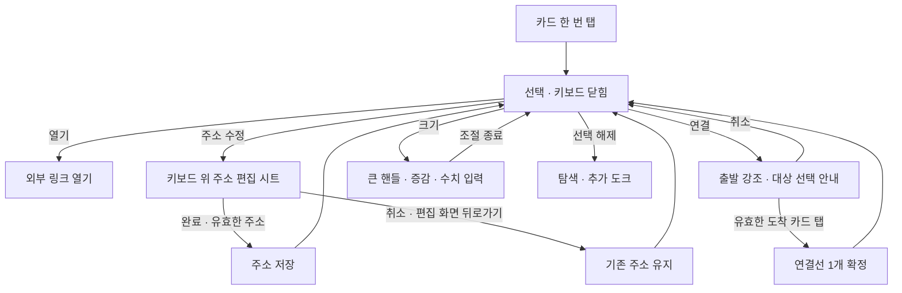

# 모바일 링크·선 연결·크기 조절 해결 계획

구현·현재 검증 상태: [구현 보고서](mobile-canvas-implementation.md). 아래 계획의 미실행 표기는 승인 당시 기록이다.

- 작성: 2026-11-12
- 상태: 2026-11-12 사용자 시작 승인에 따라 로컬 구현 및 검증. 최종 결과와 미확인 범위는 구현 보고서 참조. 아래에서 승인 당시 확정 사항과 설계 제안을 구분한다.
- 근거: [소스 조사와 Android 실기기 재현](mobile-canvas-interaction-research.md), [실기기 수치 요약](mobile-canvas-evidence/2026-11-11/android-summary.json).
- 코드 기준: `e351374604cf06c818d9dd0328e2c9a69ad9f169`. 구현 시작 전에 현재 변경과 다른 모바일 작업의 반영 여부를 다시 확인한다.

## 1. 목표와 범위

모바일에서 **카드를 선택하거나 보드를 둘러보려던 터치가 입력·리사이즈·연결과 충돌하지 않게 한다.** 작은 점을 정확히 끌지 않아도 링크 수정·두 카드 연결·크기 변경을 완료할 수 있어야 한다.

이번 범위는 모바일 링크 전용 카드, 연결 가능한 카드의 선 연결, 카드 크기 조절과 이를 구분하는 공통 입력 처리다. 일반 메모 편집기·할 일 체크 정책·문서 저장 형식·서버 API를 전면 개편하지 않는다. 데스크톱 마우스 조작, 펜, 기존 undo·협업·프레임 배치 규칙은 회귀 검증한다.

| 실기기에서 확인한 현재 동작 | 목표 |
|---|---|
| 기존 빈 링크 주소 칸 한 번 탭 → 키보드, 입력칸이 키보드에 가림 | 카드 선택 후 명시적으로 주소 수정. 입력칸과 완료·취소는 키보드 위에 유지 |
| 완성 링크 한 번 탭 → 선택 | 이 동작 유지. 외부 열기와 주소 수정을 별도 제공 |
| SE 핸들 약 196ms 드래그 → 폭 240px 그대로, 보드만 약 44×22px 이동 | 같은 조작에서 카드 크기만 변경, 보드 위치 유지 |
| 링크 B 선택 → 크기 조절점 8개, 연결점 0개인 상태 | hover 없이 선택 도구에서 연결 시작 가능 |

Android에서 정확한 연결점의 직접 드래그 실패까지 입증한 것은 아니다. 이 계획은 확인된 진입 문제와 Ego에서 확인한 마우스 전용 이벤트 경로를 함께 다룬다.

## 2. 사용자 확정 사항과 설계 제안

**2026-11-12 사용자 확정:**

1. 모바일 링크 카드 한 번 탭은 **선택**. 외부 열기는 별도 버튼.
2. 링크 주소 수정은 **완료로 저장**. 취소·뒤로가기는 기존 주소 유지.

**이번 계획의 설계 제안:**

- 단독 선택 시 모바일 하단에 카드 조작 바 표시. 일반 추가 도크와 같은 자리를 전환해 사용하고, 선택 해제로 추가 도크에 돌아간다. 카드에 따라 사용할 수 있는 동작만 제공한다.
- 링크의 신규 생성 직후에는 주소 입력 화면을 바로 연다. 입력을 종료한 뒤 기존 빈 카드가 다시 상시 입력 가능 상태가 되지 않게 한다.
- 주소 입력은 캔버스 바깥의 별도 편집 시트에서 한다. 기존 빈 링크는 읽기 표시로 렌더하고 input을 노출하지 않는다.
- 연결은 **출발 카드 선택 → 연결 → 도착 카드 탭**. 크기 조절은 **크기 버튼 → 큰 핸들 또는 증감·수치 입력**.
- 크기 변경은 기존 드래그처럼 반영하고 ‘조절 종료’로 모드만 닫는다. 복원은 undo로 한다. 주소 수정의 완료·취소 저장 정책을 크기 조절까지 확장하지 않는다.

아래는 미구현 목표 흐름이다.



하단 구성의 와이어프레임이다. 버튼은 앱 줌과 독립된 화면 좌표에 두며, 모바일 목표 hit 영역은 48×48 CSS px로 잡는다.

```text
탐색           [ 메모 ][ 할 일 ][ 사진 ][ 더 보기 ][ 휴지통 ]
링크 단독 선택 [ 열기 ][ 주소 수정 ][ 연결 ][ 크기 ][ 선택 해제 ]
주소 편집      [ URL 입력칸                 ]
               [ 취소 ][ 완료 ]               ← 키보드 위
연결 중        [ 연결할 카드를 누르세요 ][ 취소 ]
크기 조절      [ 폭 − ][ 값 ][ + ][ 조절 종료 ] ← 종류별 높이·비율 제약 반영
```

## 3. 구현 순서

### 1단계 — 터치 이벤트 충돌부터 고친다

관련: [touchCanvas.ts](../web/src/components/workspace/touchCanvas.ts), [ResizeHandles.tsx](../web/src/components/workspace/ResizeHandles.tsx), [Canvas.tsx](../web/src/components/workspace/Canvas.tsx).

- 현재 SE 터치 드래그가 크기 변경 대신 pan으로 가는 회귀 시나리오를 먼저 테스트로 고정하고 실패를 확인한다.
- 캔버스 탐색·카드 이동·크기 조절 중 **한 포인터 동작을 한 처리자만 소유**하도록 분기한다. 캡처 단계의 캔버스가 리사이즈 입력을 먼저 소비하지 않게 한다.
- 크기 조절에 Pointer Events와 pointer capture를 적용한다. 터치를 가짜 마우스 이벤트로 변환해 우회하지 않는다. 마우스도 같은 크기 계산을 사용하되 이벤트가 중복 실행되지 않게 한다.
- pointerup/cancel·capture 소실·언마운트·두 번째 손가락에 대한 종료 규칙을 정리한다. 중단 시 리스너·capture·undo 묶음을 닫고 유령 pan이나 추가 변경이 남지 않게 한다. 진행 중 리사이즈를 갑자기 pinch로 바꾸지 않고, 다음 새 제스처에서 pinch를 시작하게 한다.

### 2단계 — 선택 도구와 링크 주소 편집을 만든다

관련: [DraggableCard.tsx](../web/src/components/workspace/DraggableCard.tsx), [LinkInputFace.tsx](../web/src/components/workspace/cards/text/LinkInputFace.tsx), [linkMemo.ts](../web/src/components/workspace/linkMemo.ts), [Dock.tsx](../web/src/components/workspace/Dock.tsx).

- 단독 선택 상태의 하단 조작 바와 임시 조작 상태를 추가한다. `선택 / 주소 편집 / 연결 대상 선택 / 크기 조절`은 동시에 켜지지 않는다. 임시 상태는 공유 문서에 영속하지 않는다.
- 모바일 비편집 빈 링크의 실제 input을 제거하고 표시 요소로 둔다. `editingId`만 꺼서 활성 input이 남는 문제를 반복하지 않는다.
- 빈 링크 입력과 완성 링크 주소 수정을 같은 시트로 제공한다. 수정 중인 주소는 로컬 초안으로만 유지하고, 완료 시 검증 후 기존 저장 경로에 한 번 반영한다.
- 허용 URL 스킴·미리보기 요청의 늦은 응답 덮어쓰기 방지는 기존 규칙을 재사용한다. 잘못된 주소는 시트에 오류를 표시하고 기존 주소를 바꾸지 않는다.
- 키보드 공간 추적은 [MemoExpandDialog.tsx](../web/src/components/workspace/cards/MemoExpandDialog.tsx)의 `visualViewport.height/offsetTop` 처리와 [모바일 스타일](../web/src/components/workspace/cards/_shared/memoMobile.module.css)을 재사용·공유한다. `100vh`나 `scrollIntoView`만으로 해결했다고 보지 않는다.
- 입력·완료·취소·오류가 키보드 위에 보여야 하며 시트 내부 스크롤은 작동해야 한다. 닫은 뒤 주소 칸에 자동 재포커스하지 않고 선택 상태로 복귀한다.
- Android에서는 첫 시스템 뒤로가기가 OS에 의해 키보드만 닫을 수 있다. 키보드 닫힘만으로 저장하지 않고, 다음 뒤로가기로 편집 화면을 닫으면 초안을 버린다. 편집 화면이 열린 채 보드부터 이탈하지 않게 기존 라우팅과 연동한다.

### 3단계 — 탭으로 선을 연결한다

관련: [ConnectionHandles.tsx](../web/src/components/workspace/connectors/ConnectionHandles.tsx), [dragSession.ts](../web/src/components/workspace/connectors/dragSession.ts), [geometry.ts](../web/src/components/workspace/connectors/geometry.ts), [workspace.ts](../web/src/state/workspace.ts).

- 연결 버튼은 hover 없이 시작 가능해야 한다. 출발 카드와 ‘도착 카드를 누르세요’ 안내·취소를 표시한다.
- 현재 연결 허용 종류를 유지한다. 도착 카드의 넓은 영역을 탭하면 기존 `connectCards`로 확정한다. 기본 연결 면은 두 카드 위치로 자동 선택한다.
- 연결 대상 탭은 그 카드의 링크 열기·편집·서브보드 진입보다 우선한다. 손가락 이동은 pan으로, 짧은 탭만 도착 확정으로 구분한다. 화면 밖 대상으로 이동하는 동안 출발 선택은 유지한다.
- 자기 자신·연결 불가 카드·빈 곳 탭은 선이나 새 메모를 만들지 않는다. 같은 방향 중복 연결은 기존 중복 규칙을 따른다.
- 출발·도착 카드의 삭제 또는 보드 이동 시 초안을 종료한다. 취소는 데이터·undo 이력을 만들지 않는다. 데스크톱의 연결점 드래그는 유지한다.

### 4단계 — 모바일 크기 조절을 완성한다

- 모바일에서는 크기 모드에서 충분히 큰 조작점과 증감·수치 입력을 제공한다. 조작점의 hit 영역은 25%·50%·100% 앱 줌에서 화면상 크기를 유지한다. 조작점끼리 겹치면 대표 핸들과 패널을 사용한다.
- 링크·할 일·textbox는 현재 렌더가 내용에 맞춰 높이를 정하므로 기본적으로 **폭**을 조절하고 높이는 읽기 전용으로 다룬다. 일반 메모의 정사각형, 사진·기타 종류의 기존 비율, 프레임의 독립 폭·높이 규칙을 유지한다.
- 기존 크기 상하한, 반대쪽 모서리 고정 계산, 프레임의 자식 배치·소속 재판정, 손그림 좌표를 재사용한다. 핸들과 수치 입력이 서로 다른 계산을 구현하지 않게 한다.
- 한 번 드래그 또는 한 번 수치 입력 확정은 undo 한 단계다. 조절 종료 자체는 새 undo를 만들지 않는다. 이미 반영된 크기는 뒤로가기·중단 시 그대로 두고 undo로 복원한다.

### 5단계 — 같은 과업을 기기에서 다시 검증한다

- 단위·통합 테스트에서 입력 분기, 주소 초안/완료/취소, 연결 상태 전이, 줌 보정, undo 경계를 확인한다. 기존 관련 테스트를 삭제하거나 skip하지 않는다.
- Ego에서 touch와 mouse를 비교한 뒤 Android에서 실제 터치와 IME를 검증한다. 에뮬레이션만으로 실기기 통과를 선언하지 않는다.
- iPhone Safari는 실제 기기 확보 시 검증한다. 확보하지 못하면 iPhone 대응은 UNVERIFIED로 남긴다.
- 최종 변경 코드에서 관련 테스트, typecheck, lint, i18n, build를 실행한다. 범위가 넓은 입력 처리 변경이므로 전체 테스트도 실행한다. 기존 skip은 수와 사유를 별도 기록한다.

## 4. 완료 조건

| ID | 관찰·검증할 조건 | 검증 방법 |
|---|---|---|
| L1 | 기존 빈 링크·완성 링크 한 번 탭은 선택만. 키보드·주소 변경·외부 이동 없음 | 컴포넌트/터치 통합 테스트 + Android IME·화면 |
| L2 | 열기 버튼으로만 의도한 외부 주소가 열리고 주소 수정이 시작되지 않음 | Ego·Android 실제 버튼 탭 |
| L3 | 수정·신규 생성 화면에서 URL 입력칸·완료·취소가 키보드에 가려지지 않음 | Android 키보드 열린 상태·회전, 확보 시 Safari |
| L4 | 완료는 검증된 주소를 한 번 저장. 취소·편집 화면 뒤로가기·오버레이 닫기는 기존 주소 유지. 빈 새 카드는 기존 보존 정책 유지 | 저장 호출·문서 내용 테스트 + Android 뒤로가기 |
| L5 | 입력 중 원본 카드가 삭제되면 안전하게 닫힘. 다른 기기에서 주소가 변경되면 이를 조용히 덮어쓰지 않고 재확인 안내 | 협업/비동기 테스트 |
| C1 | hover·연속 드래그 없이 출발 선택→연결→도착 탭으로 선 1개 생성 | 통합 테스트 + Android 실제 터치 |
| C2 | 연결 대기 중 pan·화면 밖 대상 탐색 가능. 취소·무효 대상·빈 곳은 선/메모를 생성하지 않음 | 상태 전이 테스트 + 기기 시나리오 |
| R1 | SE 핸들을 48×24 CSS px 끌면 카드 크기가 변하고 world x/y·scale은 불변 | 원래 실패 회귀 테스트 + Android 전후 수치·화면 |
| R2 | 25%·50%·100% 줌에서 터치 hit 영역이 유지되고 증감·수치 입력으로도 허용 범위의 크기를 변경 가능 | 렌더/좌표 테스트 + 기기 세 배율 |
| R3 | 카드 종류별 높이·비율·프레임 배치 규칙 유지, 한 번 조작이 undo 한 단계로 복원 | 기존/신규 undo·프레임·손그림 회귀 테스트 |
| G1 | pointercancel·두 번째 손가락·선택 해제·보드 이동 후 입력 소유권/리스너/undo가 남지 않음 | 통합 테스트 + 기기 중단 시나리오 |
| G2 | 일반 pan·pinch·카드 long press 이동·펜·마우스 리사이즈/연결·표 보기가 기존대로 동작 | 관련 기존 테스트 + 마우스/터치 비교 |

조건별 PASS/FAIL/UNVERIFIED와 실행 코드 버전·기기·배율·IME 상태·증거 경로를 남긴다. Android 전면 앱과 visible 탭을 매번 확인하고, 테스트 자료는 전용 보드에 만들어 종료 후 정리를 확인한다.

## 5. 시작 전 주의할 경계

- 주소 수정에 새 완료/취소 정책을 적용해도 일반 메모의 실시간 자동 저장 정책은 바꾸지 않는다.
- 모바일 입력 분기는 화면 폭만으로 판정하지 않는다. touch/pen/mouse와 사용 가능한 화면 공간을 분리해 하이브리드 기기를 검증한다.
- 키보드/브라우저 뒤로가기, 협업 중 주소 충돌, 프레임 크기 변경은 단위 테스트만으로 완료 처리하지 않는다. 주소 충돌 재확인 UI는 정상 저장 경로와 분리한다.
- 일반 메모용 `resizeCard`의 정사각형 처리와 앞면 자동 높이 측정이 있으므로 링크에 임의의 높이를 직접 저장하는 방식은 피한다.
- 이전 Ego 샘플은 작업 공간 종료로 정리 미확인 상태다. 새 기기 테스트 준비와 함께 정리 가능 여부를 확인하되 이를 제품 수정과 혼동하지 않는다.
- 이번 산출물은 해결 계획이다. 구현·테스트·배포 성공을 의미하지 않으며, 운영 배포·push는 별도 요청 범위다.

승인 당시에는 구현·새 회귀 테스트·개선 후 기기 검증을 실행하지 않았다. 현재 실행 결과와 NOT RUN 범위는 [구현 보고서](mobile-canvas-implementation.md)에 기록했다.
