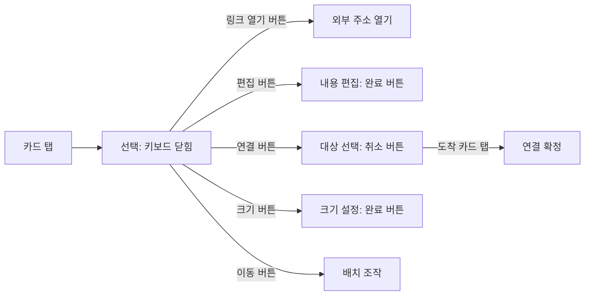

# 모바일 캔버스 조작 조사

- 조사일: 2026-11-11
- 요청: 모바일에서 선 연결·크기 조절이 어렵고, 링크 카드를 누르면 바로 수정되어 불편하다는 피드백 조사. 사용자가 최초의 ‘할 일’을 ‘링크’로 정정했다.
- 코드 기준: `/Users/donghwan/moss`, `e351374604cf06c818d9dd0328e2c9a69ad9f169`.
- 범위: 현재 코드와 기존 테스트 확인, 공식 접근성 지침·제품 도움말 조사. 후속 실행 검증은 6절에 기록한다. 제품 동작 변경은 하지 않았다.
- 판정 구분: **확인**은 소스·테스트·명시된 환경에서 관찰한 사실, **추론**은 그 사실에서 예상되는 문제, **제안**은 미구현 개선안이다. 소스 조사와 후속 Ego 터치 에뮬레이션·안드로이드 실기기 결과를 구분한다.

## 판단

모바일에서 **탐색·선택·내용 수정·배치 조작의 경계**를 분명히 하고, 선 연결과 크기 조절에 **정밀 드래그 없이 실행할 경로**를 추가하는 방향을 권한다.

현재 선 연결·크기 조절은 마우스 중심 구현이다. 조작점의 크기뿐 아니라 터치 이벤트 전달 경로도 살펴야 한다. 링크는 **주소 입력 전의 빈 카드가 편집 상태와 무관하게 활성 input을 노출**한다. 후속 Android 검증에서 빈 링크 재탭의 키보드 호출·입력칸 가림과 크기 조절 대신 pan을 재현했다. 주소가 들어간 완성 링크는 한 번 탭 시 선택만 되었다. 환경별 상세 결과는 6절, 해결 계획은 [모바일 조작 해결 계획](mobile-canvas-interaction-plan.md)에 기록한다.

## 1. 현재 구현에서 확인한 것

### 선 연결

- **확인:** 연결점은 선택된 카드가 아니라 hover 중인 카드, 연결 중인 출발·도착 카드에 나타난다. `selectedIds`는 표시 조건에 없다. 시작은 `onMouseDown`, 진행·종료는 `mousemove`·`mouseup`이다. 터치 Pointer Events 경로는 이 연결 세션에 없다. [ConnectionHandles.tsx](../web/src/components/workspace/connectors/ConnectionHandles.tsx#L13), [표시 조건](../web/src/components/workspace/connectors/ConnectionHandles.tsx#L83), [dragSession.ts](../web/src/components/workspace/connectors/dragSession.ts#L39)
- **확인:** 터치 카드 선택 경로는 `pointerdown`을 처리하고 호환 마우스 이벤트를 억제한다. 따라서 데스크톱 hover와 드래그가 터치에서도 동일하게 작동한다고 가정할 수 없다. 연결점 오버레이는 카드 내부도 아니어서 리사이즈와 이벤트 경로가 같지 않다. [touchCanvas.ts](../web/src/components/workspace/touchCanvas.ts#L28), [마우스 억제](../web/src/components/workspace/touchCanvas.ts#L90)
- **확인:** 연결점 hit 영역은 24×24이며 캔버스 world transform 아래에 있다. 역배율 크기 보정은 없다. [연결점 크기](../web/src/components/workspace/connectors/ConnectionHandles.tsx#L40), [Canvas.tsx](../web/src/components/workspace/Canvas.tsx#L679)
- **추론:** 사용자는 연결점을 찾기 어렵고, 찾더라도 한 손가락으로 계속 누른 채 작은 도착점을 맞춰야 한다. 모바일에서의 실제 성공·실패 비율은 미측정이다.

### 크기 조절

- **확인:** 단독 선택·비편집 상태에 핸들이 표시된다. 모서리 hit 영역 20×20, 가장자리 두께 16, 시각적 점 8×8이다. 이벤트는 `onMouseDown`과 window의 마우스 이벤트다. [DraggableCard.tsx](../web/src/components/workspace/DraggableCard.tsx#L1244), [ResizeHandles.tsx](../web/src/components/workspace/ResizeHandles.tsx#L18), [이벤트 등록](../web/src/components/workspace/ResizeHandles.tsx#L250)
- **확인:** 핸들은 카드 안의 `span`이고, 캔버스의 터치 예외 선택자에는 리사이즈 핸들이 없다. 캡처 단계에서 카드 터치로 처리될 수 있는 구조다. [터치 예외](../web/src/components/workspace/touchCanvas.ts#L8), [카드 터치 처리](../web/src/components/workspace/touchCanvas.ts#L28)
- **추론:** 빠르게 끌면 화면 이동, 길게 누르면 카드 이동 경로와 충돌할 수 있다. 현재 400ms long press와 8px 이동 임계값이 그 분기를 결정한다. 이 충돌은 실브라우저·실기기 재현 전까지 가설이다.

캔버스 배율에 따른 크기 계산은 다음과 같다. 브라우저 페이지 확대나 DPR이 아닌, 앱 내부 `scale()`에 의한 계산이다. 카드 회전·클리핑을 제외한 축소량이며 기기 실측값은 아니다.

| 대상 | 100% | 50% | 25% |
|---|---:|---:|---:|
| 연결점 hit 영역 | 24×24 | 12×12 | 6×6 |
| 크기 조절 모서리 hit 영역 | 20×20 | 10×10 | 5×5 |
| 가장자리 hit 두께 | 16 | 8 | 4 |

도크·줌 버튼을 44px로 만든 기존 개선은 이 world 내부 핸들의 크기를 보정하지 않는다. [canvasControls.module.css](../web/src/components/workspace/canvasControls.module.css)

### 링크 카드 — 사용자 정정 반영

| 상황 | 확인한 코드 동작 | 증거 |
|---|---|---|
| 빈 링크, 비편집 | `editing=false`여도 input은 readonly/disabled가 아닌 입력 가능 상태 | [LinkInputFace.tsx](../web/src/components/workspace/cards/text/LinkInputFace.tsx#L39) |
| 도크에서 신규 링크 생성 | 빈 링크 본문 생성 후 `setEditing(id)`, LinkInputFace가 주소 input에 포커스 시도 | [Dock.tsx](../web/src/components/workspace/Dock.tsx#L349), [포커스](../web/src/components/workspace/cards/text/LinkInputFace.tsx#L19) |
| 빈 링크의 주소 입력칸 터치 | 실제 input은 캔버스 터치 처리 예외, `data-link-input`은 카드 드래그 예외 | [touchCanvas.ts](../web/src/components/workspace/touchCanvas.ts#L8), [DraggableCard.tsx](../web/src/components/workspace/DraggableCard.tsx#L349) |
| 주소가 있는 완성 링크 | 입력칸 없는 미리보기. 인라인 편집 상태를 요청받아도 종료 | [Content.tsx](../web/src/components/workspace/cards/text/Content.tsx#L101) |
| 완성 링크 더블클릭 | `window.open`으로 외부 링크 열기. 모바일 더블탭 작동은 별도 검증 필요 | [DraggableCard.tsx](../web/src/components/workspace/DraggableCard.tsx#L1050) |

**확인:** `LinkInputFace`의 `editing` 값은 자동 포커스와 blur 시 종료 호출에 쓰인다. 실제 input에는 `readOnly`나 `disabled`가 없어 `editing=false`에서도 입력 가능한 요소다. 또한 실제 input은 캔버스 터치 처리의 예외이고, `data-link-input`은 카드 드래그 처리의 예외다. 따라서 편집 상태를 꺼도 주소 입력칸을 한 번 탭해 입력할 수 있는 구조는 남는다.

**추론:** 빈 링크에서 선택·이동하려던 터치가 입력칸 포커스나 키보드 호출로 이어져 불편할 수 있다. 다만 사용자의 증상이 빈 링크에서 발생했는지와 실제 키보드 호출은 아직 재현하지 않았다. 완성 링크에는 같은 입력칸이 없으므로 이 설명을 모든 링크 상태의 원인으로 일반화하지 않는다.

완성 링크 앞면은 인라인 편집을 요청받아도 종료하며, 카드 더블클릭은 외부 링크 열기다. 일반 메모의 펼치기 버튼도 링크 앞면에는 제공하지 않는다. 따라서 명시적인 ‘열기’와 ‘주소 수정’ 경로를 구분해 검토해야 한다. 일반 메모 본문 안의 링크를 눌러 상세를 여는 경로는 링크 전용 앞면과 별개다. [Content.tsx](../web/src/components/workspace/cards/text/Content.tsx#L91), [더블클릭](../web/src/components/workspace/DraggableCard.tsx#L1030), [버튼 조건](../web/src/components/workspace/DraggableCard.tsx#L1198)

## 2. 공식 지침과 제품 사례

| 출처·적용 범위 | 확인한 내용 | Moss에 대한 해석 |
|---|---|---|
| [W3C WCAG 2.2, 2.5.7](https://www.w3.org/WAI/WCAG22/Understanding/dragging-movements), 웹 AA | 드래그 기능은 본질적으로 필요한 경우 등을 제외하고 드래그 없는 단일 포인터 조작을 제공한다. 출발 항목과 도착 항목을 차례로 눌러 선을 연결하는 예시가 있다 | 연결을 ‘출발 카드 → 연결 → 도착 카드 탭’으로 제공할 근거. 키보드 단축키만 추가하는 것으로 대체되지 않는다 |
| [W3C WCAG 2.2, 2.5.8](https://www.w3.org/WAI/WCAG22/Understanding/target-size-minimum.html), 웹 AA | 기본 기준 24×24 CSS px. 간격·동등 조작·문장 내 링크·사용자 에이전트·본질적 배치 등의 예외가 있다 | 24를 터치 UX의 충분조건으로 해석하지 않는다. 실제 변환 후 크기·간격·겹침·대체 조작을 확인해야 한다 |
| [Apple HIG Buttons](https://developer.apple.com/design/human-interface-guidelines/buttons), Apple 플랫폼 | 일반적으로 버튼 hit 영역 44×44pt 이상, 주변 간격과 눌림 피드백을 권장한다 | 그림은 작게 두고 손가락이 닿는 영역은 키울 수 있다 |
| [Android Developers](https://developer.android.com/guide/topics/ui/accessibility/views/apps-views), Android 앱 | 48×48dp 이상의 터치 영역을 권장하며 padding으로 작은 그림의 조작 영역을 확장할 수 있다 | 웹에서는 화면상 44–48 CSS px를 제품 목표로 삼는 안을 검증하되 pt·dp·CSS px를 같은 단위라고 쓰지 않는다 |
| [Miro Mobile app](https://help.miro.com/hc/en-us/articles/360017572834-Mobile-app), iOS·Android 앱 | 기본 탐색은 view-only. 객체 선택 후 Edit, 더블탭 텍스트 입력, 길게 눌러 이동. 연결은 선택 → Edit → 파란 점 드래그 | 선택·편집 분리는 직접적인 참고 사례. Miro도 연결은 드래그하므로 ‘경쟁사는 모두 탭 연결’이라고 할 수 없다 |
| 같은 Miro 문서, 모바일 브라우저 | 앱을 사용할 수 없을 때 브라우저에서 보드 보기·댓글 기능을 안내한다 | 네이티브 앱 조작을 모바일 웹에서 그대로 가능하다고 가정하지 않는다 |
| [Figma mobile app](https://help.figma.com/hc/en-us/articles/1500007537281-Guide-to-the-Figma-mobile-app), 기기 구분 | FigJam 편집은 iPad 앱 항목에 명시되어 있다 | iPad FigJam 사례를 iPhone·Android 폰의 편집 UX 증거로 쓰지 않는다 |
| [FigJam for iPad](https://help.figma.com/hc/en-us/articles/4502073572247-FigJam-for-iPad), iPad 조작 안내 | 그리기 도구가 비활성일 때 기존 객체 한 번 탭은 선택·툴바 표시. 새로 추가한 shape·sticky·text는 바로 편집 상태 | 기존 객체 선택과 신규 생성 후 빠른 입력을 구분하는 참고 사례. 페이지에는 Figma 앱으로의 이전 공지와 옛 앱 설명이 함께 남아 있어 현재 세부 동작은 실기 확인 필요 |

이는 공식 지침·문서 조사이며, 경쟁 제품을 실기기로 비교한 사용자 실험은 아니다. Moss의 WCAG 준수 여부 전체를 판정한 접근성 감사도 아니다.

추가 공식자료 교차 조사는 완료했다. FigJam의 선택·신규 생성 구분은 위 원문에서 다시 확인해 반영했다. Freeform 관련 추가 자료는 이번 부모 조사에서 원문 조회가 429로 실패해 확정 근거로 추가하지 않았다.

## 3. 추천하는 조작안 — 미구현 제안

### 공통: 탭은 선택, 화면에 보이는 버튼으로 의도를 정한다



선택 툴바는 world의 작은 카드에 붙여 함께 축소하기보다 화면 좌표의 하단 등에 배치하는 안을 권한다. 표시 중인 모드·선택 대상·취소 경로가 보여야 한다. 모든 모드를 동시에 노출하지 않고 선택 후 필요한 도구를 보여준다.

### 링크: 선택·열기·주소 수정 분리

- **카드 본문 탭은 선택**, 외부 사이트로 가는 **열기**, 주소를 바꾸는 **수정**을 별도 조작으로 제공하는 안을 권한다. 한 번의 탭이 선택과 수정 또는 외부 이동을 동시에 일으키지 않게 한다.
- 빈 링크도 비편집 상태에서는 주소 입력칸을 비활성 표시 또는 일반 텍스트로 보여 선택·이동이 가능하게 한다. 편집 상태값만 바꾸고 실제 input을 활성 상태로 남기면 이 문제를 해결하지 못한다.
- **신규 링크 생성 직후는 주소를 붙여넣으려는 의도가 명확하므로 바로 입력하는 예외를 유지하는 안**을 권한다. 편집을 마치거나 중단한 뒤에는 선택 상태로 돌아오게 한다.
- 완료·취소 경로를 화면에 표시한다. 빈 주소로 종료했을 때 카드 보존, 수정 중 취소·외부 탭의 저장 정책은 이번 조사에서 새로 확정하지 않는다.
- 완성 링크의 URL 수정 진입과 외부 열기를 각각 검증한다. 더블탭·long press를 유일한 경로로 두지 않는다. 본문 내 링크와 링크 전용 카드는 혼동하지 않는다.

### 선 연결: 출발 선택 → 연결 → 도착 탭

- 작은 점을 찾아 누른 채 끌 필요 없이 목적 카드의 넓은 영역을 누르게 한다. 연결 면은 자동 선택을 기본 후보로 검토한다.
- ‘연결할 카드를 선택하세요’와 출발 카드 강조, 취소 버튼을 표시한다. 목적 카드가 화면 밖이면 연결 대기 상태를 유지한 채 캔버스를 이동할 수 있어야 한다.
- 연결 모드에서는 도착 카드 탭을 링크 열기·편집·보드 진입보다 우선하는 의도적인 모드로 취급한다. 잘못된 대상·자기 자신·빈 곳을 눌렀을 때 데이터가 뜻밖에 생기지 않도록 한다.
- 기존 마우스 드래그는 유지할 수 있다. 모바일에서는 tap 경로를 기본으로 제안한다.

### 크기 조절: 화면 고정 조작 + 드래그 없는 정밀 조절

- 선택 후 크기 버튼으로 조절 의도를 명시한다. 화면 좌표에서 충분히 큰 핸들을 제공하고 터치 이벤트 소유자를 분리한다.
- 작은/보통/큰 프리셋은 빠른 조작용이다. 기존 자유 크기 변경을 동등하게 제공하려면 폭·높이 수치 입력 또는 누를 수 있는 증감 조작도 필요하다. 프리셋 세 개만으로 동등 대체라고 단정하지 않는다.
- 텍스트 상자처럼 높이가 자동인 종류의 기존 제약은 유지한다. 너비 변경 시 텍스트·손그림·프레임 자식 배치의 기존 의미를 바꾸지 않는다.
- 두 손가락 핀치는 캔버스 확대·축소에 유지하는 안을 권한다. 선택 카드 리사이즈에 동시에 할당하면 같은 제스처의 의미가 상태에 따라 바뀐다.

## 4. 우선순위와 선택의 비용

| 순서 | 제안 | 이유·비용 |
|---|---|---|
| 1 | 선택 상태에서 편집·연결·크기 조절 진입을 명시하고 터치 이벤트 경로를 분리 | 사용자 의도와 제스처가 충돌하는 공통 원인에 대응. 버튼 하나만 키워서는 끝나지 않는다 |
| 2 | 링크의 선택/외부 열기/주소 수정 경로 구분 | 빈 링크의 상시 활성 input과 선택 의도의 충돌에 대응. 열기·수정에 조작이 추가되므로 명시적인 버튼이 필요하다 |
| 3 | 출발→도착 탭 연결 | 연속 정밀 조작 제거. 모드 표시·취소·화면 밖 대상 탐색 설계가 필요하다 |
| 4 | 화면 크기를 유지하는 핸들 + 수치·증감 크기 조절 | 축소 상태에서도 조작 가능. 작은 카드 주변 hit 영역 겹침과 가림을 해결해야 한다 |

터치 입력·coarse pointer를 함께 고려하고, 화면 폭만으로 폰·마우스를 단정하지 않는다. 하이브리드 기기에서는 펜·마우스 입력도 유지해야 한다. 화면 고정 툴바는 safe area와 키보드에 가려지지 않아야 한다.

## 5. 최초 코드 조사 시점의 검증과 남은 확인

최초 조사에서는 **4개 파일, 33개 테스트 통과, 실패·skip 0**이었다. 당시 Todo로 알고 실행한 readonly·행 click 토글 검증은 링크 증상의 근거로 사용하지 않는다. 나머지는 카드 터치 탐색·long press·취소·undo, 마우스 리사이즈 undo, 연결 상태 로직 테스트다.

링크로 정정한 뒤 2026-11-11 같은 코드에서 아래 명령을 추가 실행해 **3개 파일, 9개 테스트 통과, 실패·skip 0**을 확인했다. 주소 검증·링크 본문 반영, 도크 생성 후 편집 상태 등의 기존 테스트다. 비편집 빈 링크의 입력 활성은 소스 확인이며, 이 9개 테스트가 그 상태의 모바일 터치·소프트 키보드 동작을 검증한 것은 아니다.

```sh
cd web
bun run test src/components/workspace/cards/text/__tests__/LinkInputFace.test.tsx src/components/workspace/__tests__/Dock.linkTodoPhoto.test.tsx src/components/workspace/__tests__/DraggableCard.memoVariety.test.tsx
```

| 항목 | 판정 | 근거·다음 확인 |
|---|---|---|
| 현재 이벤트 구현·핸들 크기 조사 | PASS | 기준 커밋 소스 확인 |
| 기존 관련 테스트 | PASS | 최초 33/33, 링크 정정 후 추가 실행 9/9. 서로 다른 검증 범위 |
| 공식 가이드·제품 사례의 근거 확인 | PASS | 위 1차 자료. 앱·폰·태블릿·웹의 범위를 구분 |
| 빈 링크의 편집 상태와 무관한 입력 활성 | PASS | `LinkInputFace` input에 readonly/disabled 제어가 없고 터치·카드 드래그 예외에 해당하는 것을 소스에서 확인 |
| 보고된 ‘링크 탭 → 즉시 수정’의 실기기 재현 | UNVERIFIED | 빈 링크인지·완성 미리보기인지, 생성 직후인지, 본문 내 링크인지 구분 필요 |
| 선 연결·크기 조절의 실기기 실패 재현 | UNVERIFIED | 이번 조사에서 실기기 조작하지 않음 |
| 개선안의 사용성 효과 | UNVERIFIED | 미구현 제안. 사용자 실험·기기 검증 전 |

NOT RUN: 전체 테스트·lint·typecheck·build(제품 코드 변경 없음), iPhone Safari·Android Chrome 실기기, 운영 버전 대조, 경쟁 제품 실기기 비교, 사용자 과업 실험.

후속 검증은 iPhone Safari와 Android Chrome, 앱 캔버스 배율 25%·50%·100%, 세로·가로 화면을 포함한다. 빈 링크·완성 링크·생성 직후·본문 내 링크, 키보드 열린 상태를 따로 확인한다.

| 과업 | 개선안 검증 시 관찰할 조건 |
|---|---|
| 기존 링크 선택 | 빈 링크·완성 링크 본문 한 번 탭에 키보드·주소 변경·외부 이동 없음 |
| 외부 링크 열기 | 열기 버튼으로 해당 주소 이동, 주소 편집 시작 없음 |
| 주소 수정 | 수정 버튼으로 입력 시작, 화면상 완료·취소로 종료 |
| 선 연결 | 드래그 없이 두 카드 연결, 화면 밖 대상으로 탐색 가능, 취소 시 생성·변경 없음 |
| 크기 변경 | 축소 상태에서도 조작 가능. 수치·증감 경로 제공, 카드 이동·캔버스 핀치와 혼동 없음 |
| 중단·복구 | 두 번째 손가락·pointercancel·화면 회전·뒤로가기 시 오작동 없음. 확정한 변경은 기대하는 단위로 undo |

처음 쓰는 사용자가 설명 없이 과업을 수행하게 하고 완료 시간·오조작·불필요한 키보드 호출·도움 요청을 기록한다. 몇 명의 초기 탐색 결과만으로 정량적인 개선율을 주장하지 않는다.

## 6. 후속 실행 재현 — Ego와 Android 구분

2026-11-11 사용자가 Ego Browser와 연결된 Android를 사용한 재현을 요청했다. `https://moss.dongpark.dev`의 로그인된 화면에서 확인했다. 운영 배포의 정확한 Git SHA는 확인하지 않았으므로 로컬 기준 커밋과 같다고 단정하지 않는다. [Ego 환경·정적 자산 지문](mobile-canvas-evidence/2026-11-11/ego-environment.json)

### 환경

- Ego Browser: TaskSpace 26, 별도 테스트 파일함 안에 직접 만든 완성 링크 A와 빈 링크 B. 터치 시험에서는 411×752 CSS px, `Emulation.setTouchEmulationEnabled`, CDP `Input.dispatchTouchEvent`를 사용했다. 이는 **터치 에뮬레이션이며 안드로이드 실기기 결과가 아니다**. Ego 실행 간 viewport가 기본값으로 돌아가 매 시험 안에서 다시 설정했다.
- Android: USB 연결 Samsung SM-N986N, Android 13, Chrome 157.0.8103.48, 화면 1440×3088, 웹 viewport 약 411×752 CSS px, DPR 3.5. 실제 화면 입력은 `adb shell input tap`, 관찰은 Chrome 원격 DOM·ADB 스크린샷·IME 상태를 사용했다.
- 자료 보호: 기존 카드는 수정하지 않고 새 테스트 카드만 만들었다. 테스트 자료의 정리는 전체 재현 종료 후 확인한다.

### 관찰 결과

| 과업 | 환경 | 관찰 | 판정 |
|---|---|---|---|
| 빈 링크 입력칸 다시 탭 | Ego 터치 에뮬레이션 | 포커스 해제 후 `BODY`가 활성인 상태에서 한 번 터치하면 `INPUT/링크`로 바뀐다. input은 `readOnly=false` | 입력 포커스 재진입 재현. 실제 소프트 키보드 증거는 아님 |
| 완성 링크 A의 SE 크기 조절 핸들 빠르게 끌기 | Ego 터치 에뮬레이션 | 시작 대상이 `data-resize-handle=se`인 실제 포인터 이벤트. width 240px와 카드 좌표는 그대로인데 world가 `translate(0,0)`에서 `translate(48,24)`로 바뀐다 | 크기 변경 대신 캔버스 이동 재현 |
| A의 bottom 연결점을 B까지 끌기 | Ego 터치 에뮬레이션 | 연결점 발견 단계를 제외하기 위해 마우스 hover로 먼저 노출했다. 시작 hit-test와 실제 pointerdown 대상 모두 bottom 연결점임을 확인. 터치 이동·해제 후 연결선 0개, world도 불변 | 연결점에 정확히 닿은 터치 드래그로 연결되지 않는 현상 재현 |
| 같은 연결점→같은 대상에 마우스 드래그 | Ego 마우스 비교 시험 | 연결선 1개 생성(SVG의 hit path·visible path 합계 2). 이후 Control+z로 0개 복원 | 동일 테스트 대상이 마우스에서는 연결됨 |
| 새 빈 링크 생성 | Android 실기기 | 더 보기→링크 선택 직후 input에 포커스, IME `mInputShown=true`, 키보드가 올라오는 스크린샷 확보 | 신규 생성 직후 키보드 호출 관찰. 기존 링크 재탭 증상과 구분 |
| 기존 빈 링크 재탭·선 연결·크기 조절, 1차 시도 | Android 실기기 | 신규 생성 뒤 다른 앱이 전면으로 전환되어 후속 물리 입력을 중단했다. 백그라운드 Moss DOM과 다른 앱의 화면을 결합해 판정하지 않는다 | 당시 보류. 사용자 재개 승인 후 아래 추가 실행 |

연결 시험에서는 SVG `<defs>`의 화살표 marker path를 선 개수로 세지 않고, 실제 `path[stroke]`를 확인했다. 첫 탐색 중 연결점이 아닌 다른 요소에 닿은 시도는 연결 재현의 근거에서 제외했다. 위 표는 시작 대상이 연결점임을 확인한 후 다시 실행한 결과다.

### 증거

- 빈 링크: [터치 전후 DOM](mobile-canvas-evidence/2026-11-11/ego-link.json), [입력 포커스 화면](mobile-canvas-evidence/2026-11-11/ego-link-retap.png).
- 크기 조절: [좌표·이벤트 기록](mobile-canvas-evidence/2026-11-11/ego-resize.json), [시도 전](mobile-canvas-evidence/2026-11-11/ego-resize-before.png), [시도 후](mobile-canvas-evidence/2026-11-11/ego-resize-after.png).
- 연결: [터치 기록](mobile-canvas-evidence/2026-11-11/ego-connection-touch.json), [시도 후](mobile-canvas-evidence/2026-11-11/ego-connection-touch.png), [마우스 비교·정리](mobile-canvas-evidence/2026-11-11/ego-mouse-control.json).
- Android: [새 링크 생성 화면과 올라오는 키보드](mobile-canvas-evidence/2026-11-11/android-new-link-keyboard.png), [기기 DOM](mobile-canvas-evidence/2026-11-11/android-new-link.json).

### 사용자 재개 승인 후 Android 실기기 결과

사용자가 ‘기기 테스트 계속해도 돼’라고 응답한 뒤 Chrome의 전면 상태와 **현재 보이는 Moss 탭**을 확인해 재개했다. 원격 디버깅 목록의 첫 Moss 탭을 무조건 고르지 않고 `document.visibilityState=visible`인 탭을 선택했다. 모든 물리 입력 전에 전면 앱이 Chrome인지 확인했다.

| 과업 | 실제 입력·관찰 | 결과 |
|---|---|---|
| 기존 빈 링크 재탭 | 페이지 재진입 후 `BODY`가 활성이고 키보드가 닫힌 상태. 기존 빈 링크의 주소 칸을 ADB로 한 번 탭 | `INPUT/링크` 활성, Android IME `mInputShown=true`. 생성 직후가 아닌 재탭에서도 키보드 호출 **재현** |
| 링크 입력칸의 키보드 가림 | 재탭 후 visual viewport 높이가 약 752.57→358.86 CSS px로 줄어듦. 주소 칸의 y는 약 390.29px | 키보드가 입력칸을 가리는 화면 **관찰**. 포커스 진입뿐 아니라 입력 중 가시성 문제도 있음 |
| 완성 링크 한 번 탭 | 같은 테스트 카드에 주소를 입력·확정한 뒤 앞면을 한 번 탭 | `BODY` 활성, IME 닫힘, 단독 선택·리사이즈 핸들 표시. 이 상태에서는 ‘탭 즉시 주소 수정’을 **재현하지 못함** |
| SE 크기 조절 핸들 빠르게 끌기 | 약 196ms의 실제 touch pointerdown→move→up. 시작 target에 `data-resize-handle=se` 확인 | 카드 width 240px·left 80px·top 360px 유지. world만 `(0,0)`→`(44.1601,22.08)`로 이동. **크기 조절 대신 pan 재현** |
| 완성 링크 B 선택 후 선 연결 진입 | B를 두 번에 걸쳐 단독 선택. 리사이즈 핸들은 8개, 연결점은 0개 | 선택만으로 연결 조작을 시작할 수 없는 상태 **재현**. A에서는 앞선 탭 후 연결점 4개가 나타난 기록도 있어, 모든 탭에서 항상 숨겨진다고 일반화하지 않음 |

Android의 연결점 직접 드래그 시험은 시작점을 확보하지 못해 수행하지 못했다. CDP mouse hover로 진입점을 노출하려는 보조 시도도 실패했으며, 실제 native touch gesture는 보내지 않았다. 따라서 ‘정확한 연결점에서 끌어도 연결되지 않음’은 **Ego 에뮬레이션 결과**이고, Android에서 확인한 것은 **탭 선택 후 연결점 진입이 불안정한 상태**다.

드래그 시간에 따른 분기를 더 보려던 `adb input draganddrop` 보조 시도는 앱의 400ms hold 조건을 충족한 조작으로 검증되지 않아, long press가 카드를 이동시킨다는 근거로 쓰지 않는다.

실기기 증거:

- [전후 수치 요약](mobile-canvas-evidence/2026-11-11/android-summary.json)
- 빈 링크 [재탭 전 화면](mobile-canvas-evidence/2026-11-11/android-link-before.png), [재탭 후 키보드와 가려진 입력칸](mobile-canvas-evidence/2026-11-11/android-link-keyboard.png), [재탭 전 DOM](mobile-canvas-evidence/2026-11-11/android-link-before.json), [재탭 후 DOM](mobile-canvas-evidence/2026-11-11/android-link-after.json)
- [완성 링크 선택 기록](mobile-canvas-evidence/2026-11-11/android-complete-link-selected.json)
- 크기 조절 [시도 전](mobile-canvas-evidence/2026-11-11/android-resize-before.png), [시도 후](mobile-canvas-evidence/2026-11-11/android-resize-after.png), [전 상태](mobile-canvas-evidence/2026-11-11/android-resize-before.json), [후 상태와 실제 터치 이벤트](mobile-canvas-evidence/2026-11-11/android-resize-after.json)
- 연결 진입 [선택 화면](mobile-canvas-evidence/2026-11-11/android-connection-selection.png), [핸들 개수 기록](mobile-canvas-evidence/2026-11-11/android-connection-selection.json)

### 정리와 한계

Android에서 이번에 만든 링크 A·B는 UI 선택과 Delete 키로 휴지통에 이동했다. 기존 카드 4개가 모두 남아 있고 world가 원래의 `translate(0px, 0px) scale(1)`로 복원된 것을 확인했다. [정리 확인](mobile-canvas-evidence/2026-11-11/android-cleanup.json)

Ego는 재개 시 `task space not found: 26`으로 기존 작업 공간이 사라져 있었다. 새 공간으로 우회하지 않았다. 따라서 Ego에서 만든 테스트 링크·파일함의 정리는 **UNVERIFIED**이며 정리가 끝났다고 주장하지 않는다. 이번 작업으로 만든 항목은 루트 링크 `c-mwc63gwd-1`, 테스트 파일함 `c-mwc66bn3-2`, 그 안의 링크 `c-mwc6794q-3`·`c-mwc67aqp-4`다.

제품 코드는 바꾸지 않았다. NOT RUN: Android에서 정확한 연결점의 직접 터치 드래그, iPhone Safari, 25%·50% 배율의 실기기 반복, 개선안 구현·효과 검증, 종료된 Ego 공간의 테스트 자료 정리.
