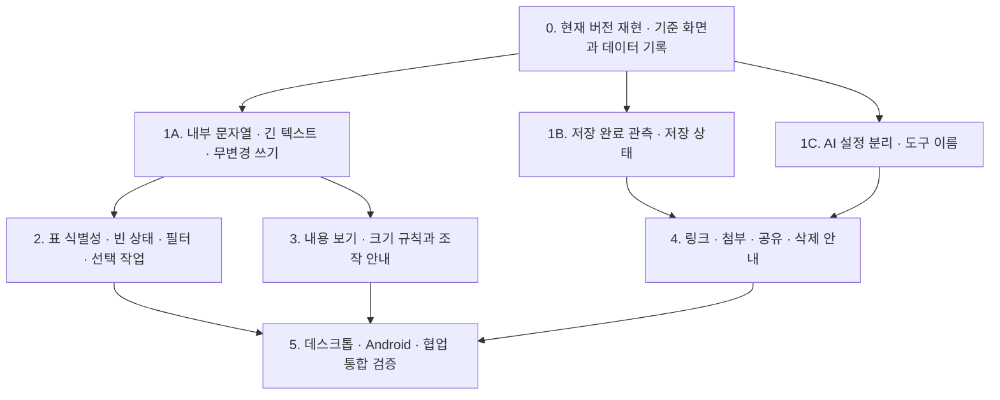

# Moss UI/UX 리뷰 개선 계획

- 작성: 2026-11-13
- 상태: 2026-11-13 개선 구현·자동 검증 완료. 조건별 PASS/UNVERIFIED와 실기기·협업 미확인 범위는 [구현·검증 기록](ui-ux-review-implementation.md) 참조. 아래 절차와 완료 조건은 승인된 계획이다.
- 기준 코드: `36fe2060fc9ee2e40074826d203e4238cc9a3c6d`
- 근거: 첨부 `moss-ui-ux-review-ko.pdf` 전체 7쪽의 본문·화면, 현재 소스, [기존 모바일 계획](mobile-canvas-interaction-plan.md), [구현 보고서](mobile-canvas-implementation.md).
- 이번 산출물은 구현 순서와 완료 조건이다. PDF의 관찰은 리뷰 당시 결과이며, 아래 소스 확인은 현재 화면의 재현 성공을 뜻하지 않는다.

## 1. 목표와 확정 정책

**사용자가 무엇을 만들고 있는지, 내용이 비었는지, 어디에 저장됐는지, 크기를 어떻게 바꾸는지 화면에서 알 수 있게 한다.** 표의 내부 문자열 노출과 긴 텍스트의 가로 확장을 먼저 해결하고, 같은 입력·저장·선택 상태를 캔버스와 표에서 일관되게 설명한다.

### 사용자 확정: 2026-11-13

1. **빈 메모·할 일·링크는 표·검색에서 계속 표시한다.** 빈 상태를 명확히 안내한다. 기본 숨김, 별도 초안 분류, 새 자동 삭제 정책은 도입하지 않는다. 검색어가 있는 경우에는 제목·유형 등 사용자에게 보이는 정보로 일치 여부를 판정한다. 내부 표식은 검색 대상이 아니다.
2. **카드 종류별 크기 규칙을 유지한다.** 일반 메모는 정사각형, 텍스트·할 일·링크는 내용에 따른 높이, 메모판은 폭·높이 조절이다. 사진·파일함의 기존 비율 규칙도 유지한다.

이 두 답변은 PDF의 ‘빈 초안 숨김·분리’와 ‘모든 카드의 폭·높이 독립 조절’ 권고보다 우선한다. 기존 텍스트 도구(textbox)의 빈 편집 종료 처리는 별도 기존 기능이며, 이번에 다른 카드로 확대 적용하지 않는다.

### 유지할 기존 동작

- 일반 메모는 실시간 자동 저장한다. 펼친 창의 닫기는 편집 취소가 아니다.
- 모바일 링크는 한 번 탭하면 선택, 별도 버튼으로 외부 열기. URL 수정은 완료로 저장하고 취소·뒤로가기는 원본 유지다([기존 계획 §2](mobile-canvas-interaction-plan.md)).
- 카드 위치는 보드의 공용 좌표다. 화면 폭이 바뀌었다고 카드를 자동 재배치하거나 저장된 크기를 다시 쓰지 않는다.
- 파일함(`kind: board`)은 하위 캔버스의 입구이고, 메모판(`kind: frame`)은 현재 캔버스의 묶음이다. 파일 첨부와는 다르다.

그 외 아래 UI 구성은 이 계획의 설계 제안이다. 공유 권한·AI 전송 정책·저장 형식을 새로 정하는 작업은 포함하지 않는다.

## 2. PDF와 현재 코드의 대조

| ID / PDF 근거 | 리뷰의 관찰·권고 | 현재 소스에서 확인한 내용 | 계획에서 다루는 방식 |
|---|---|---|---|
| U01 · p.3~4 | 빈 링크의 `<!-- moss-link-empty -->` 노출 | `linkContent.ts`에 영속 표식이 있고, `memoSearch.ts`의 평문 변환에는 이 표식을 제거하는 분기가 없음. 표는 이 결과를 사용 | P0: 표시·검색에서 내부 표현 분리. 저장 표식은 유지 |
| U02 · p.6 | 긴 무공백 텍스트가 가로로 확장 | textbox 자동 폭은 `white-space: pre`, textarea `wrap=off`, 한 줄 측정값을 사용 | P0: 자동 폭 상한과 상한 도달 후 줄바꿈. 편집·읽기 모두 확인 |
| U03 · p.2,4,7 | 저장 상태와 펼친 창 닫기의 의미 불명확 | 일반 메모는 실시간 반영, 300ms 미러 저장 예약·flush 경로 존재. 공유 provider의 연결 상태와 첫 동기화 신호는 개별 변경의 영속 완료 증거가 아님 | P0: 실제 저장 완료·실패에 연결된 상태 관측부터 추가 |
| U04 · p.4,7 | 편집 근처에서 AI 설정을 실수로 변경 | 선택 카드 우상단 24px 버튼이 즉시 `toggleAIOptOut` 호출. 펼치기 버튼도 우상단에 위치 | P0: 개인정보 설정을 이름 있는 별도 영역으로 이동 |
| U05 · p.2,4,6 | 아이콘 의미, 더 보기, 도구별 차이 불명확 | Dock에 라벨 키·hover 이름표·모바일 더 보기 경로가 있음 | P1: 기존 이름을 키보드·터치에서도 발견 가능하게 제공 |
| U06 · p.2~4 | 빈 항목·반복되는 제목 없음, 할 일의 원시 문자 | 표가 저장 제목과 평문 본문을 사용. 메모·할 일·링크는 같은 `text` 종류에 서로 다른 앞면 | P1: 유형·대체 표시 제목·구체적 빈 상태·완료 개수 제공. 숨기지 않음 |
| U07 · p.3 | 활성 필터·결과 개수·선택 범위 식별 어려움 | 보드·하위 보드·메모판·첨부 필터 및 다중 선택 경로는 이미 존재 | P1: 칩·결과 수·초기화·선택 대상 범위 추가 |
| U08 · p.2,5 | 큰 메모판이 전체 보기 배율을 낮춤 | 현재 새 메모판 기본값은 320×220. 전체 보기는 프레임을 포함한 경계를 계산. 초기 맞춤 함수도 따로 존재 | P1: 리뷰의 큰 크기를 먼저 재현. ‘내용 보기’와 ‘전체 보기’ 구분 |
| U09 · p.5,7 | 메모판 리사이즈 실패, 높이 조절 발견 어려움 | 메모판 높이 입력과 Pointer Events 공통 크기 계산 존재. 배경 이미지가 있는 판은 원본 비율 제약 | P1: 실제 실패 조건 조사·피드백 개선. 전 종류 자유 리사이즈로 대체하지 않음 |
| U10 · p.4,7 | 파일함이 업로드 도구처럼 보이며 빈 상태 설명 부족 | `cards/board/Content.tsx`는 하위 캔버스 진입·이름·메모 개수를 표시 | P1: 열기·메모 넣기 안내. 파일 업로드 버튼 신설로 해석하지 않음 |
| U11 · p.4 | 링크 검증·미리보기 실패 안내 필요 | URL 검증, 미리보기, 늦은 응답 덮어쓰기 방지, 모바일 별도 편집 시트가 있음 | P1: 기존 경로를 재사용해 상태·복구 안내 점검 |
| U12 · p.4 | 사진·파일 지원 형식·용량·저장 위치 안내 | 공통 첨부 한도 모듈과 사진·메모 첨부 경로 존재. PDF에서는 실제 업로드 미실행 | P1: 진입 전 안내와 실제 업로드/거절 시나리오 검증 |
| U13 · p.4 | 공유 전 업로드 범위·초대·권한·해제 설명 부족 | 미공유 팝오버는 짧은 설명과 시작 버튼. 기존 스펙상 공유 루트 아래 파일함도 같은 멤버에게 열림 | P1: 실제 하위 보드·첨부 범위를 확인해 문구 작성 |
| U14 · p.3~4 | 삭제 대상·개수·실행 취소·영구 삭제 안내 | 표 다중 선택·휴지통·undo 기능 존재 | P1: 기존 확인 UI 점검 후 부족한 대상·개수·복원 안내 보강 |
| U15 · p.1,6 | 점검 중 빈 항목 수정일 갱신, 다양한 폭·입력 회귀 필요 | 저장 merge는 호출 시 수정일을 갱신. 제목 무변경 방어는 별도로 존재 | P0 조사: 읽기·선택·크기 측정만으로 쓰는 경로가 있는지 추적. 원인 미확정 |

PDF는 한 계정에서 수행한 정성 리뷰다. 사진·파일 실제 업로드, 공유 시작, 외부 연결은 검증하지 않았다. 메모판 드래그 실패도 원인을 확정하지 않았으므로 ‘크기 변경 기능 없음’으로 기록하지 않는다.

## 3. 작업 순서와 의존성



단계별로 검증 가능한 묶음으로 진행한다. 달력 기준 ‘1주차·2주차’는 구현 규모와 재현 결과를 확인하기 전에는 확약하지 않는다. `workspace.ts`, `DraggableCard.tsx`, `Dock.tsx`를 함께 건드리는 작업은 순차 통합한다.

### 0단계: 현재 버전에서 기준을 만든다

- 전용 테스트 보드에서 PDF의 빈 메모·빈 할 일·빈 링크·긴 텍스트·새 메모판·빈 파일함을 재현한다. 기존 사용자 자료를 편집하거나 휴지통을 비우지 않는다.
- 390px·820px·데스크톱에서 화면, 배율, 카드 저장 크기와 실측 크기를 함께 남긴다. 리사이즈 실패는 선택 상태·입력 종류·배율·배경 이미지 유무를 기록한다.
- 빈 카드의 읽기·선택·펼치기·닫기·표 전환 전후에 본문·제목·수정일을 비교한다. 내용 변경 없이 수정일만 바뀌는 경로를 찾되, 실제 편집·이동의 수정일 의미는 바꾸지 않는다.
- 기존 모바일 구현 보고서의 PASS는 과거 증거로 참조한다. 이번 코드의 통과로 재사용하지 않는다.

완료 기준: U01~U15별로 `재현 / 소스 경로 확인 / 미재현 / UNVERIFIED`와 코드 버전을 기록한다. 재현되지 않은 증상을 고친 것으로 처리하지 않는다.

### 1단계: 잘못된 표시와 실수 위험부터 해결한다

**1A. 표시·검색, 가로 확장, 불필요한 쓰기**

- 저장된 내부 표식은 모델에 남기고 사용자용 변환 단계에서 제외한다. 정상 URL·사용자가 쓴 코드·링크 제목을 지우는 광범위한 문자열 제거는 피한다. 표와 캔버스 검색이 같은 의미를 사용하게 한다.
- 긴 텍스트는 자동 폭의 상한에 도달하면 세로로 줄바꿈한다. 상한은 공용 디자인 값으로 관리하고, 수동 폭은 기존 크기 계산을 따른다. 기존 저장 카드나 화면 회전만으로 공유 크기를 일괄 변경하지 않는다.
- 좁은 화면에서는 편집 영역·완료·취소 등 조작이 가로 이동 없이 접근 가능해야 한다. 무한 캔버스의 화면 밖 카드 자체와 문서/도구의 가로 넘침을 구분한다.
- 무변경 쓰기가 재현되면 원래 호출 경로를 고친다. `updatedAt` 전역 갱신을 끄거나 실제 쓰기를 숨기는 방식으로 우회하지 않는다.

**1B. 저장 상태**

- UI 상태를 넣기 전에 로컬 문서 영속·미러 쓰기·공유 동기화·첨부 업로드의 완료/실패 신호를 구분한다. 작업 도중 더 최신 편집이 생기면 이전 완료 응답으로 ‘저장됨’이 되지 않게 한다.
- 보드 상단과 펼친 편집창에 같은 상태를 표시한다. 로컬은 ‘이 기기에 저장 중 / 이 기기에 저장됨 / 저장 실패’, 공유는 별도로 ‘연결 중 / 동기화 중 / 연결 끊김 / 동기화 오류’를 설명한다.
- 연결 성공이나 첫 sync만으로 ‘서버에 저장됨’을 표시하지 않는다. 서버 영속 확인이 제공되지 않으면 그 사실에 맞는 동기화 문구를 사용한다. 정확한 완료 확인에 프로토콜 변경이 필요하면 별도 범위로 분리해 제시한다.
- 실패 시 편집 내용을 유지하고 재시도 경로를 제공한다. 닫기 근처에는 ‘자동 저장 · 닫아도 변경 유지’를 안내한다. 일반 메모에 새 저장/취소 초안 정책을 넣지 않는다.

**1C. AI 설정과 도구 진입**

- 편집·펼치기·연결 근처의 즉시 AI 토글을 제거하고, 선택 카드의 이름 있는 ‘개인정보’ 영역에 ‘AI 처리 허용/제외’ 상태를 제공한다. 비선택 상태의 제외 배지는 읽기 표시로 유지한다.
- 카드 한 개에 적용되는 설정과 전역 설정의 범위를 분명히 표시한다. 기존 전송 차단 정책은 유지한다.
- 도크의 이름을 hover 외에도 키보드 포커스와 모바일 더 보기에서 제공한다. 더 보기에는 이름과 한 줄 설명을 함께 표시한다. 주 도크 전체에 라벨을 항상 펼쳐 화면을 가리지 않게 한다.

### 2단계: 표에서 내용을 구분하고 정리하게 한다

- 공통 표시 정보로 유형, 빈 상태, 대체 표시 제목, 미리보기, 할 일 진행 개수를 만든다. 저장 제목이 있으면 우선하고, 없으면 본문의 첫 유효 줄·링크 제목/주소 등을 표시한다. 이것은 표시용 파생값이며 저장 제목 자동 생성이 아니다.
- 완전히 빈 항목은 각각 ‘빈 메모 / 할 일을 추가하세요 / 주소를 입력하세요’로 안내한다. 제목만 있거나 첨부·손그림·체크 항목이 있는 카드를 빈 항목으로 오분류하지 않는다. 빈 행도 유지한다.
- 할 일은 `[x] / [ ]` 원시 문자열 대신 ‘완료 2/5’처럼 읽을 수 있게 표시한다. 표에서 직접 체크 상태를 변경하는 새 기능은 추가하지 않는다.
- 검색은 저장 제목·유효 본문과 화면에 표시하는 유형/빈 상태 정보를 일관되게 다룬다. 표시 제목만 추가해 제목 편집·정렬이 뜻밖에 달라지지 않도록 표시와 저장 필드를 구분한다.
- 활성 필터 칩, 검색 결과 수, 개별 해제, 전체 초기화를 제공한다. 초기화는 기존 `defaultFilters(currentBoardId)`를 재사용한다: 검색어 없음, 현재 보드와 하위 보드 포함, 메모판·첨부 조건 없음. 검색 입력의 150ms 대기값이 초기화 직후 재적용되지 않게 한다.
- 선택 개수와 실제 작업 대상을 표시한다. 필터 변경 후 가려진 선택을 포함할지 기존 동작을 조사하고, 숨은 대상이 삭제될 수 있는 경우 그 개수까지 작업 전에 안내한다. 필터 변경만으로 삭제하지 않는다.
- 모바일의 카드형 표와 기존 키보드 이동·다중 선택·가상화를 유지한다.

### 3단계: 캔버스 방향감과 크기 규칙을 드러낸다

- 기존 전체 보기는 유지하고 별도 ‘내용 보기’를 제공한다. 내용 보기는 내용 카드의 경계를 중심으로 계산해 빈 메모판 여백 때문에 본문까지 축소되는 문제를 줄인다.
- 메모판만 있거나 내용이 없으면 전체 보기로 안내한다. 파일함은 접근할 내용이므로 대상에 포함하고, 프레임 배경 자체를 보고 싶은 경우 전체 보기를 사용한다. 기존 초기 맞춤과 사용자가 조정한 뷰포트를 임의로 덮어쓰지 않는다.
- 새 메모판 320×220이 실제로 어떻게 보이는지 확인한 뒤 기본 크기 변경 필요성을 판정한다. 수치만 줄이기 전에 생성 배율·배경·멤버 크기·실측 높이 문제를 확인한다.
- 크기 패널에는 실제 허용 동작을 설명한다: ‘정사각형 크기’, ‘폭 · 높이는 내용에 맞춤’, ‘사진/파일함 비율 유지’, ‘메모판 폭·높이’. 배경 이미지 비율에 의해 메모판 높이가 연동되면 그 이유를 표시한다.
- 프레임 리사이즈는 마우스와 터치에서 재현하고 최소·최대 제한, 숫자 입력 반영값, 활성 모드와 종료를 안내한다. AI 제외 자물쇠가 ‘크기 잠금’으로 오인되지 않게 의미를 분리한다.
- 비어 있는 첫 보드에는 ‘메모 만들기’와 유형별 한 줄 안내를 제공한다. 자료가 있는 보드에서 온보딩이 내용을 가리지 않게 한다.
- 미니맵·카드 자동 재배치·메모판 자동 확장·크기 프리셋은 후속 후보로 둔다. 이번에는 명시적 내용 보기와 기존 조작의 이해 가능성을 먼저 검증한다.

### 4단계: 링크·첨부·공유·삭제의 결과를 예측하게 한다

- 링크: 형식 오류, 미리보기 불러오는 중/실패, 재시도·주소 수정 경로를 구분한다. 미리보기 실패와 주소 저장 실패는 다르다. URL 수정의 기존 완료/취소·동시 변경 방어를 유지한다.
- 파일함: 빈 상태에 ‘열어서 메모를 넣으세요’, 선택 도구에 명시적 ‘열기’를 제공한다. 이름의 ‘0개’가 파일 수가 아니라 메모 수임을 설명한다. 카드 드롭 안내는 실제 지원되는 입력에서만 표시한다.
- 사진·파일 첨부: 각 실제 입력 경로의 형식·용량·개수 제한을 읽어 안내와 검증이 같은 값에 의존하게 한다. 현재 공통 상한은 이미지 10MiB, 일반 첨부 50MiB, 한 번에 드롭 20개이며, 도구별 허용 형식과 저장 위치는 별도로 확인한다. 선택만 했을 때, 실패했을 때, 업로드 중일 때의 상태도 제공한다.
- 공유: ‘이 보드만 서버에 올라가요’를 하위 파일함·첨부까지 포함한 실제 범위와 대조한다. 초대 링크 소지자의 가입/접근 조건, 멤버 역할, 공유 해제 뒤 접근 중단과 기존 로컬 사본의 관계를 서버·sync 구현에서 확인한 뒤 평이한 문장으로 작성한다([기존 하위 보드 정책](share-subboards.md)). 정책 자체는 바꾸지 않는다.
- 휴지통: 복원·영구 삭제·비우기에 실제 대상 이름과 개수를 표시한다. 기존 영구 삭제 확인이 있다면 재사용하고, 실행 취소의 대상과 실제 유효 시간을 알린다. 파일함과 하위 자료가 함께 영향을 받는 경우 이를 포함한다.

### 목표 화면의 핵심 정보 배치 예시

아래는 미구현 구성 예시다. 좁은 화면의 버튼 배치는 구현 때 실측한다.

```text
보드 상단      [캔버스 | 표]   [이 기기에 저장됨]   [공유 상태]
캔버스 탐색    [내용 보기] [전체 보기] [배율]
카드 크기      폭 [280]  · 높이는 내용에 맞춤       [조절 종료]
개인정보       이 메모 · AI 처리 [허용 / 제외]

표 도구        [검색] [보드 ×] [첨부 있음 ×] [필터 초기화]  결과 4개
표 행          [링크] 주소를 입력하세요   · 빈 링크   · 보드 경로
표 행          [할 일] 장보기            · 완료 2/5 · 보드 경로
선택 작업      3개 선택 · 작업 대상 3개   [휴지통으로] [선택 해제]
펼친 편집창    자동 저장 · 닫아도 변경 유지   [이 기기에 저장됨] [닫기]
```

## 4. 완료 조건과 검증

구현 후 각 조건에 PASS / FAIL / UNVERIFIED를 기록한다. 지금은 모두 구현 후 검증할 조건이다.

| AC | 관찰 가능한 완료 조건 | 검증 방법 |
|---|---|---|
| UX-01 | 빈 링크는 유지되며 표·검색 미리보기에 내부 표식이 안 보이고, 내부 표식 검색만으로 결과가 생기지 않음. 정상 링크·사용자 코드 내용 유지 | 평문/행 파생/검색 단위 테스트 + 캔버스·표 화면 |
| UX-02 | 빈 메모·할 일·링크 3개가 무검색 표와 해당 유형/빈 상태 검색에서 접근 가능. 제목·본문·체크 항목·첨부·손그림을 가진 자료는 보존 | 유형/빈 상태 파생 테스트 + 새로고침·표/캔버스 왕복 |
| UX-03 | 무공백 500자·긴 URL·한영 혼합·XL 텍스트가 자동 폭 상한에서 줄바꿈. 읽기/편집 모두 내용 유실 없음. 좁은 화면의 입력·도구는 문서 가로 넘침 없이 접근 가능 | 실제 브라우저 레이아웃 측정, 320/390/820px, 가로모드·200% 브라우저 확대 |
| UX-04 | 최신 편집에 대한 로컬 영속 성공 전에는 저장 완료가 뜨지 않고 실패는 오류·재시도 표시. 공유 연결/첨부 업로드를 저장 완료와 혼동하지 않음 | 저장 지연·실패·응답 역전·오프라인 주입 테스트 + 재로드 복원 |
| UX-05 | 펼친 일반 메모를 닫은 뒤 최신 편집이 유지되고 자동 저장 설명이 보임. 링크의 완료 저장·취소/뒤로가기 원본 유지도 유지 | 편집/flush/내비게이션 통합 테스트 + Android IME |
| UX-06 | 카드 선택·편집·확대·연결 조작으로 AI 상태가 바뀌지 않음. 명시적 개인정보 조작만 해당 카드 상태를 바꾸며 전역 범위도 구분 가능 | 포인터/키보드 통합 테스트 + 좁은 화면 실제 버튼 조작 |
| UX-07 | 각 생성 도구가 키보드·터치에서 이름과 실제 결과로 식별되고, 더 보기를 닫아도 유령 카드나 자동 설정 변경 없음 | Dock 회귀 테스트 + 데스크톱/Android |
| UX-08 | 제목 없는 행에도 유형·대체 표시 제목·보드 맥락이 보이고 할 일은 완료 개수로 읽힘. 단순 열람/대체 제목 표시로 원본 제목·본문이 바뀌지 않음 | 행 파생·표 컴포넌트 테스트 + 원본 데이터 전후 비교 |
| UX-09 | 필터 칩·결과 수가 일치하고 개별 해제/초기화 직후 이전 검색이 재적용되지 않음. 선택 작업의 표시 개수와 실제 휴지통 대상 일치 | 필터·디바운스·다중 선택 통합 테스트 + 모바일 카드형 표 |
| UX-10 | 큰 빈 프레임과 메모 2개를 둔 경우 내용 보기가 프레임 여백을 제외해 메모에 맞춤. 전체 보기는 프레임을 포함. 회전/화면 변경만으로 카드 위치·크기가 바뀌지 않음 | 경계 계산 테스트 + 두 보기 전후 수치·화면 |
| UX-11 | 메모 정사각형·자동 내용 높이·사진/파일함 비율·프레임 폭/높이 규칙 유지. 제한값/배경 비율 안내가 실제 결과와 일치. 한 번 조작은 undo 한 단계 | cardSizing/ResizeHandles/프레임·undo 회귀 + 마우스·Android 25/50/100% 앱 배율 |
| UX-12 | 빈 파일함에서 열기·메모 넣기 방법과 개수 의미가 보임. 사진/파일은 선택 전 제한 안내, 정상 입력은 복원 가능, 초과/미지원 입력은 명시적 거절 | 전용 보드의 실제 파일 선택·드롭·재로드 + 제한값 테스트 |
| UX-13 | 공유 시작 전에 하위 파일함·첨부의 업로드 범위와 접근/해제 설명을 읽을 수 있고 실제 두 계정 동작과 일치 | 서버·sync 권한 테스트 + 전용 두 계정 공유/해제 검증 |
| UX-14 | 삭제/비우기 확인의 대상·개수가 실제 효과와 일치하고, 실행 취소는 표시한 기간 내에 해당 대상만 복원 | 휴지통·undo·파일 보존 회귀 + 실제 UI |
| UX-15 | 읽기·선택·펼치기/닫기·표 전환만 한 카드의 제목·본문·수정일은 유지. 실제 편집과 협업 변경은 누락 없이 반영 | 원인 재현 테스트 + DB/Y.Doc·두 클라이언트 전후 비교 |
| UX-16 | Tab·Enter·Escape·스크린리더 이름으로 주요 도구/설정/닫기를 이용 가능하고, 모바일 IME가 입력·종료 버튼을 가리지 않음 | 접근성 역할/이름·포커스 테스트 + 키보드 탐색·Android 실기기, 확보 시 Safari |

### 검증 실행 범위

- 단위: `memoSearch`, `memoTable`, 카드 유형/빈 상태, 저장 상태 전이, 내용 경계, 크기 계산.
- 통합: 표 필터/선택, 저장 실패/재시도, 편집창 닫기, 개인정보, 리사이즈/연결/undo, 첨부 생명주기.
- 브라우저: 320/390/820px·데스크톱, 앱 배율 25/50/100%, 브라우저 확대 200%, 긴 텍스트·20개 이상 할 일·이미지 비율·키보드 탐색. 창 폭과 touch/mouse 판정은 별도로 확인한다.
- 실기기: Android 세로/가로+IME, 뒤로가기·회전·pinch·연결·리사이즈. iPhone Safari와 실제 펜은 확보하지 못하면 UNVERIFIED로 남긴다.
- 협업: 두 클라이언트에서 동시 편집·설정 변경·삭제·공유 해제·접속 복구. 로컬 저장과 상대 반영과 서버 영속의 증거를 구분한다.
- 최종 코드: `web/`에서 `bun run test`, `bunx tsc --noEmit`, `bun run lint`, `bun run check:i18n`, `bun run build`. 관련 서버/sync를 바꾸면 해당 테스트도 포함한다. 환경별 실행 옵션은 로그에 명시하고 실패를 skip으로 우회하지 않는다.
- 각 결과에는 코드 SHA, 기기/브라우저, 화면 폭·배율·IME 상태, 명령/로그·전후 화면을 연결한다. 기존 skip은 수와 사유를 별도 기록한다.

## 5. 구현 경계와 후속 후보

| 묶음 | 주로 영향을 받는 코드 | 주의할 경계 |
|---|---|---|
| 표시·검색·표 | `state/linkContent.ts`, `memoSearch.ts`, `memoTable.ts`, `components/workspace/table/` | 모델 표식과 표시값 분리, 저장 제목·정렬 의미, 가상화와 키보드 |
| 텍스트·크기·보기 | `cards/textbox/Content.tsx`, `cardSizing.ts`, `MobileResizeControls.tsx`, `ResizeHandles.tsx`, `Canvas.tsx`, `state/workspace.ts` | 공용 좌표·저장 크기, 기존 비율·손그림·프레임 소속·undo |
| 저장 상태 | `state/cardPersist.ts`, `ydoc/doc.ts`, `collab/provider.ts`, `collab/store.ts`, `WorkspaceShell.tsx`, `MemoExpandDialog.tsx` | Y.Doc 원본과 Dexie 미러, 실제 트랜잭션 완료, 동기화/영속 차이 |
| 진입·개인정보 | `Dock.tsx`, `MobileCardControls.tsx`, `DraggableCard.tsx`, `components/privacy/`, i18n | 터치 hit 영역·설정 범위·드래그 전파, 숨긴 기존 도구의 임의 복원 금지 |
| 링크·첨부·공유·삭제 | `MobileLinkEditor.tsx`, `linkMemo.ts`, `cards/board/Content.tsx`, `cards/photo/`, `state/attachmentLimits.ts`, `components/share/`, 기존 휴지통 UI | URL 초안과 자동 저장 구분, 파일함 의미, 하위 공유·첨부 보존 |

다음은 이번 계획의 필수 구현에서 제외한다: 빈 카드 숨김/초안 분리/자동 삭제 도입, 제목의 AI 자동 생성·원본 일괄 수정, 모든 카드 자유 리사이즈, 미니맵, 자동 재배치, 메모판 자동 확장·프리셋, 표에서 할 일 직접 체크, 공유 권한 정책 개편. 기본 크기 수치 변경은 0·3단계 증거를 보고 필요성을 따로 판정한다.

완료 보고는 AC별 판정과 남은 위험을 담는다. 특히 ① 서버 영속 확인 신호의 범위 ② 원인 미확정 메모판 조절 실패 ③ 열람 중 수정일 갱신 ④ Safari·물리 펜·실제 협업 미검증을 숨기지 않는다.

## 6. 계획 작성 당시의 검증 기록 (구현 전)

- PDF 7쪽을 모두 텍스트 추출하고 PNG로 렌더해 화면·본문·제한사항을 확인했다.
- 위 표의 소스 경로, 기존 모바일·하위 공유 문서와 현재 코드 기준을 대조했다.
- 상대 링크 4개, PDF 지적 사항 U01~U15와 완료 조건 UX-01~UX-16의 연속성, 코드 펜스 짝, 사용자 확정 정책, 줄 끝 공백을 스크립트로 확인했다. 제품 코드 변경은 없다.

NOT RUN: 이번 리뷰 항목의 현재 앱 재현, 개선 구현, 자동 테스트·타입 검사·린트·빌드, Android/Safari·협업 실행 검증, CI·배포. 기존 보고서의 테스트 결과를 이번 작업의 PASS로 주장하지 않는다.
